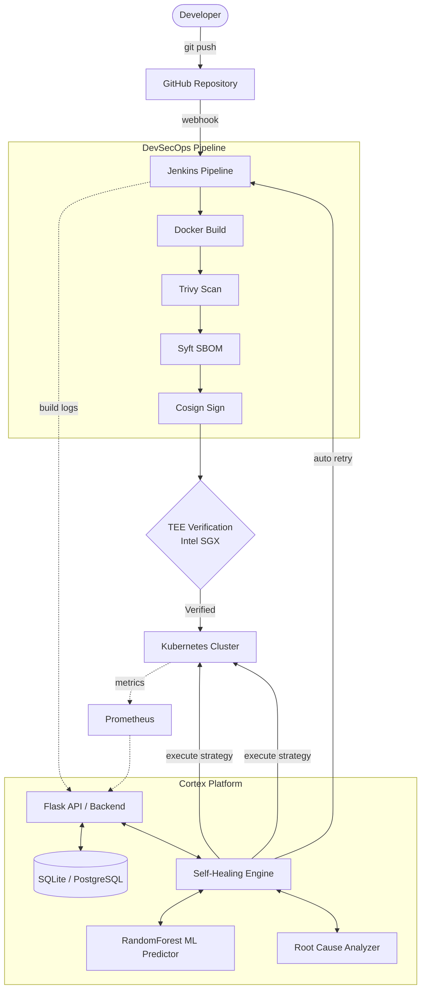
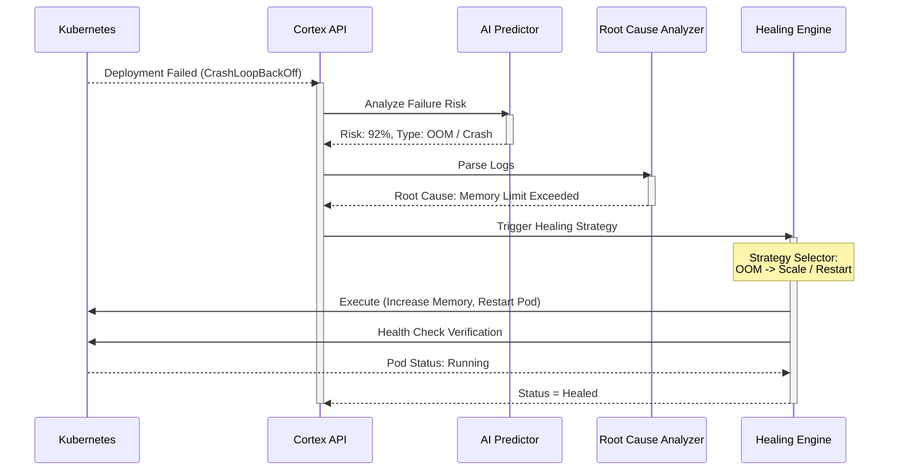
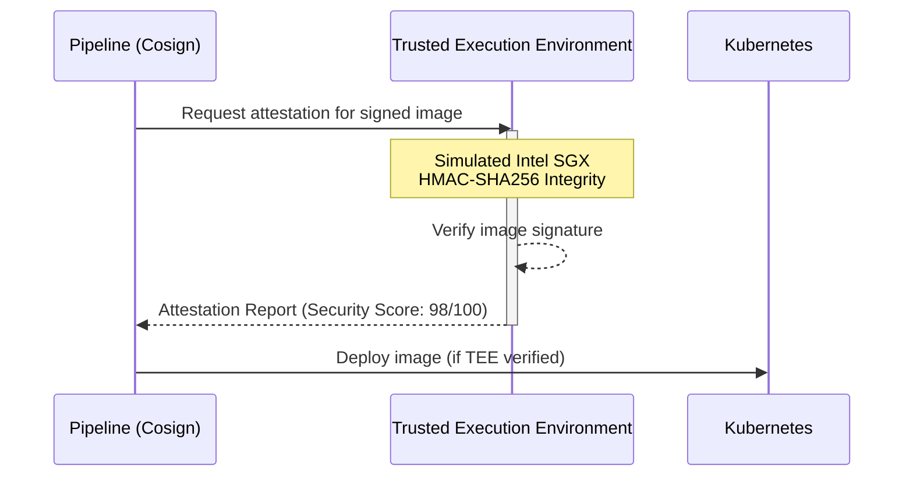
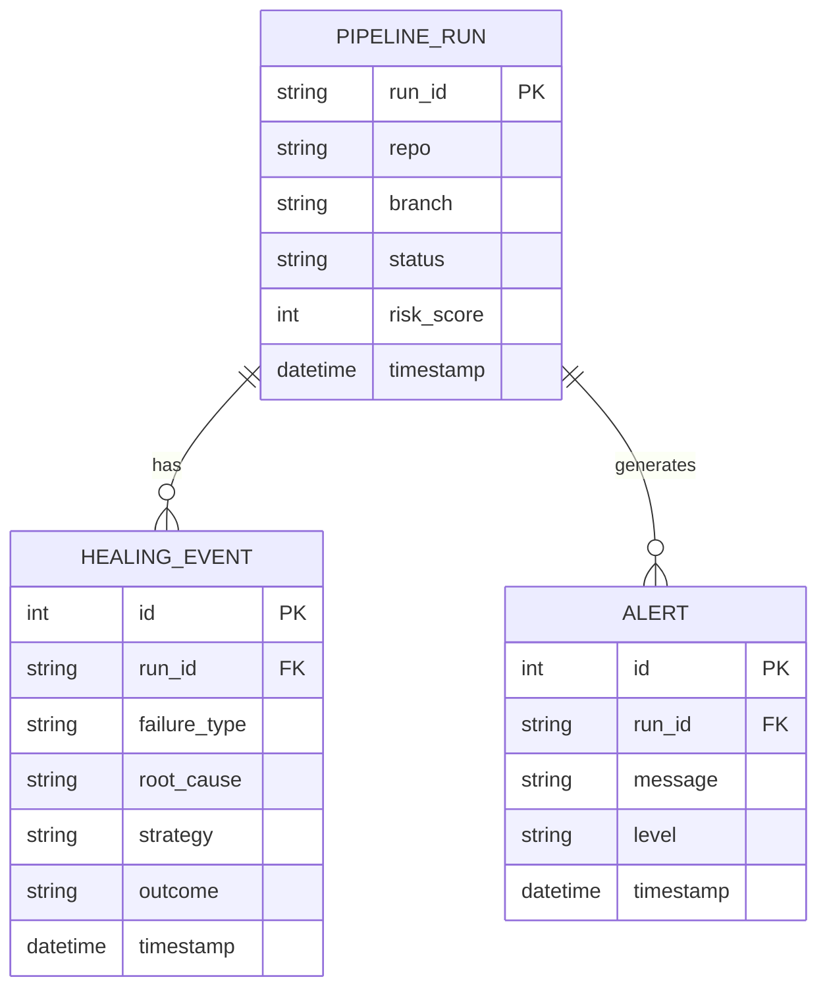

# Cortex CI/CD — Self-Healing Pipeline 🧠

<div align="center">
  <h3>Deploy without fear. We heal the rest.</h3>
  <p>Cortex intercepts CI/CD failures in real-time, diagnoses root causes with ML, and autonomously recovers before you even notice.</p>
</div>

---

## 📋 Table of Contents
- [Overview](#overview)
- [Architecture](#architecture)
- [Technology Stack](#technology-stack)
- [Screenshots](#screenshots)
- [Self-Healing AI Workflow](#self-healing-flow-ai-incident-timeline)
- [TEE Workflow](#tee-workflow)
- [Features](#features)
- [Folder Structure](#folder-structure)
- [Getting Started](#getting-started)
- [API Reference](#api-reference)
- [Environment Variables](#environment-variables)
- [Deployment Guide](#deployment-guide)
- [Security](#security)
- [Future Roadmap](#future-roadmap)
- [License](#license)

---

## 🚀 Overview

Cortex is a next-generation CI/CD monitoring and self-healing platform. Unlike traditional pipelines that simply fail and page a developer at 3 AM, Cortex uses machine learning and autonomous agents to:

1. **Predict** failures before they happen using risk scoring (RandomForest ML model)
2. **Intercept** pipeline crashes in real-time via Jenkins integration
3. **Diagnose** root cause using rule-based pattern matching + log analysis
4. **Heal** the infrastructure autonomously (restart pods, rollback deployments, scale replicas)
5. **Attest** sensitive operations inside a Trusted Execution Environment (TEE)

---

## 🏛️ Architecture



---

## 🛠️ Technology Stack

- **Backend:** Flask, Python 3.10+, SQLAlchemy
- **Machine Learning:** Scikit-Learn (RandomForest)
- **Frontend:** HTML5, Vanilla JS, Glassmorphism CSS
- **DevSecOps:** Jenkins, Docker, Kubernetes
- **Security:** Trivy, Syft, Cosign
- **Observability:** Prometheus, Grafana
- **Testing:** Pytest

---

## 📸 Screenshots

*(Before uploading, place your screenshots in the `app/static/images/` folder and link them here)*

- **Dashboard Preview:** ``
- **Pipeline View:** ``
- **Kubernetes Monitor:** ``
- **AI Prediction:** ``
- **Self-Healing Incident Timeline:** ``
- **TEE Security Status:** ``

---

## 🔄 Self-Healing Flow (AI Incident Timeline)



---

## 🔒 TEE Workflow



---

## 🗄️ Database Schema



---

## ⚡ Features

| Feature                  | Status   | Description                                               |
|--------------------------|----------|-----------------------------------------------------------|
| Premium Dashboard        | ✅ Live  | Glassmorphism UI with real-time stats                     |
| Pipeline Management      | ✅ Live  | Trigger real Jenkins builds, view runs                    |
| ML Failure Prediction    | ✅ Live  | RandomForest risk score + failure type prediction         |
| Root Cause Analysis      | ✅ Live  | 7 failure pattern library with log matching               |
| Self-Healing Engine      | ✅ Live  | AutoRetry, PodRestart, Rollback, ScaleUp, Escalate        |
| Background Scheduler     | ✅ Live  | Polls every 30s, auto-heals unresolved failures           |
| Jenkins Integration      | ✅ Live  | Real API + graceful mock fallback                         |
| Docker Integration       | ✅ Live  | Real Docker SDK + graceful mock fallback                  |
| Kubernetes Integration   | ✅ Live  | Real k8s client + graceful mock fallback                  |
| Prometheus Integration   | ✅ Live  | Metrics scraping + mock fallback                          |
| TEE Security             | ✅ Live  | Simulated Intel SGX attestation + sealed secrets vault    |
| Security Scanner         | ✅ Live  | Container image scan (Trivy) + secret detection           |
| Notifications            | ✅ Live  | Slack webhook + SMTP email escalation                     |
| PDF/JSON Reports         | ✅ Live  | Downloadable pipeline + healing reports                   |
| Authentication           | ✅ Live  | Session-based login                                       |

---

## 📁 Folder Structure

```text
CortexCICD/
├── app/               # Main Flask app, routes, healing engine, templates
├── docker/            # Dockerfiles for the API and workers
├── jenkins/           # Pipeline scripts (Jenkinsfile with DevSecOps tools)
├── kubernetes/        # K8s manifests (deployment, RBAC, services)
├── ml/                # AI models, dataset generation, and prediction logic
├── monitoring/        # Prometheus and Grafana dashboards
├── reports/           # PDF and CSV report generation logic
├── security/          # Secret scanning and Trivy/Syft/Cosign integrations
├── tee/               # Trusted Execution Environment (Intel SGX simulation)
├── tests/             # Comprehensive pytest suite (API, ML, Healing)
└── requirements.txt   # Python dependencies
```

---

## 📦 Getting Started

### Prerequisites

- Python 3.10+
- pip
- (Optional) Docker Desktop — for live container data
- (Optional) `kubectl` + kubeconfig — for live K8s data
- (Optional) Jenkins instance — for live pipeline data

### Run Locally (Python)

```bash
# 1. Clone the repository
git clone https://github.com/CortexCICD/Self-Healing-CI-CD.git
cd Self-Healing-CI-CD

# 2. Create a virtual environment
python -m venv venv
venv\Scripts\activate        # Windows
# source venv/bin/activate   # Linux/Mac

# 3. Install dependencies
pip install -r requirements.txt

# 4. Configure environment (optional — has sensible defaults)
copy .env .env.local
# Edit .env with your JENKINS_URL, JENKINS_TOKEN, etc.

# 5. Run the Flask app
python -m app.app
```

Navigate to **http://localhost:5000** and login with `admin / admin`.

### Run with Docker Compose

```bash
docker-compose -f docker/docker-compose.yml up --build
```

Services started:
- `cortex-api` on port **5000**
- `prometheus`  on port **9090**
- `grafana`     on port **3000**
- `redis`       on port **6379**

---

## 📡 API Reference

All endpoints require session authentication (login at `/login`).

### Pipeline

| Method | Endpoint                          | Description                         |
|--------|-----------------------------------|-------------------------------------|
| POST   | `/api/pipeline/run`               | Trigger Jenkins build + create DB record |
| GET    | `/api/stats`                      | Dashboard statistics (JSON)         |

**POST `/api/pipeline/run` body:**
```json
{ "job_name": "CortexCICD/Self-Healing-CI-CD", "branch": "main" }
```

### ML & AI

| Method | Endpoint                          | Description                         |
|--------|-----------------------------------|-------------------------------------|
| GET    | `/api/predict/<run_id>`           | ML failure risk + type prediction   |
| POST   | `/api/analyze`                    | Root cause analysis for a failure   |

**POST `/api/analyze` body:**
```json
{
  "failure_type": "OOM — Pod Evicted",
  "log_snippet": "OOMKilled: memory limit exceeded",
  "run_id": "RUN-4816",
  "pod_restarts": 3,
  "risk_score": 88
}
```

**GET `/api/predict/<run_id>` response:**
```json
{
  "risk_score": 88,
  "failure_type": "OOM — Pod Evicted",
  "confidence": 0.91,
  "confidence_label": "Very High",
  "recommended_action": "Restart Pod",
  "alternative_action": "Increase memory limit",
  "model": "RandomForest"
}
```

### Self-Healing

| Method | Endpoint                          | Description                         |
|--------|-----------------------------------|-------------------------------------|
| POST   | `/api/heal/<run_id>`              | Trigger full healing cycle          |
| GET    | `/api/healing/status`             | Recent healing events               |

**POST `/api/heal/<run_id>` optional body:**
```json
{
  "pod_name": "cortex-api-pod",
  "deployment_name": "cortex-api",
  "job_name": "CortexCICD/Self-Healing-CI-CD",
  "namespace": "default",
  "failure_type": "OOM — Pod Evicted"
}
```

### Docker

| Method | Endpoint                            | Description              |
|--------|-------------------------------------|--------------------------|
| GET    | `/api/docker/containers`            | List all containers      |
| POST   | `/api/docker/restart/<id>`          | Restart a container      |
| DELETE | `/api/docker/remove/<id>`           | Remove a container       |
| GET    | `/api/docker/stats/<id>`            | Container CPU/memory     |

### Kubernetes

| Method | Endpoint                            | Description              |
|--------|-------------------------------------|--------------------------|
| GET    | `/api/k8s/pods`                     | List pods                |
| GET    | `/api/k8s/nodes`                    | List nodes               |
| GET    | `/api/k8s/deployments`              | List deployments         |
| GET    | `/api/k8s/services`                 | List services            |
| POST   | `/api/k8s/restart/<pod_name>`       | Restart a pod            |
| POST   | `/api/k8s/scale/<deployment_name>`  | Scale a deployment       |

### Jenkins

| Method | Endpoint                              | Description              |
|--------|---------------------------------------|--------------------------|
| GET    | `/api/jenkins/jobs`                   | List all jobs            |
| POST   | `/api/jenkins/trigger/<job_name>`     | Trigger a build          |
| GET    | `/api/jenkins/log/<job>/<build_num>`  | Get console log          |

### TEE Security

| Method | Endpoint              | Description                     |
|--------|-----------------------|---------------------------------|
| GET    | `/api/tee/status`     | TEE enclave summary             |
| GET    | `/api/tee/attestation`| Remote attestation report       |
| POST   | `/api/tee/seal`       | Seal a secret into the enclave  |
| GET    | `/api/tee/secrets`    | Vault metadata (no values)      |

### Security

| Method | Endpoint                    | Description                |
|--------|-----------------------------|----------------------------|
| POST   | `/api/security/scan`        | Scan container image       |
| GET    | `/api/security/secrets`     | Scan repo for secrets      |

### Reports

| Method | Endpoint                    | Description                       |
|--------|-----------------------------|-----------------------------------|
| GET    | `/api/reports/pipeline`     | Download pipeline report (PDF)    |
| GET    | `/api/reports/healing`      | Download healing report (PDF)     |
| GET    | `/api/reports/ai/<run_id>`  | Download AI analysis report (PDF) |

---

## 🔧 Environment Variables

| Variable           | Default                              | Description                              |
|--------------------|--------------------------------------|------------------------------------------|
| `SECRET_KEY`       | random                               | Flask session secret key                 |
| `FLASK_ENV`        | `development`                        | Flask environment                        |
| `JENKINS_URL`      | `http://localhost:8080`              | Jenkins server URL (empty = mock mode)   |
| `JENKINS_USER`     | `admin`                              | Jenkins username                         |
| `JENKINS_TOKEN`    | *(empty)*                            | Jenkins API token (empty = mock mode)    |
| `DOCKER_HOST`      | auto-detect                          | Docker daemon socket                     |
| `K8S_KUBECONFIG`   | `~/.kube/config`                     | Path to kubeconfig file                  |
| `K8S_NAMESPACE`    | `default`                            | Kubernetes namespace                     |
| `PROMETHEUS_URL`   | `http://localhost:9090`              | Prometheus server URL                    |
| `SLACK_WEBHOOK_URL`| *(empty)*                            | Slack webhook for escalation alerts      |
| `SMTP_HOST`        | `smtp.gmail.com`                     | SMTP server for email alerts             |
| `SMTP_USER`        | *(empty)*                            | SMTP username                            |
| `SMTP_PASS`        | *(empty)*                            | SMTP password                            |
| `ALERT_EMAIL_TO`   | *(empty)*                            | Recipient for escalation emails          |
| `TEE_MODE`         | `simulated`                          | TEE mode: `simulated` or `sgx`          |
| `TRIVY_PATH`       | `trivy`                              | Path to Trivy binary                     |

> **Mock Mode:** Every integration (Jenkins, Docker, K8s, Prometheus) automatically falls back to realistic simulated data if the real service is not reachable. No configuration required to run locally.

---

## 🚢 Deployment Guide

### Kubernetes (Production)

```bash
# 1. Apply RBAC for the healing agent
kubectl apply -f kubernetes/healing-rbac.yaml

# 2. Deploy all components
kubectl apply -f kubernetes/

# 3. Check deployment status
kubectl get pods -n default
kubectl get svc -n default
```

Key manifests:
- `kubernetes/deployment.yaml` — main application deployments
- `kubernetes/healing-rbac.yaml` — RBAC for self-healing operations
- `kubernetes/hpa.yaml` — Horizontal Pod Autoscaler

### CI/CD Pipeline (Jenkinsfile)

The included `jenkins/Jenkinsfile.example` implements a modern DevSecOps pipeline:
1. **Checkout** — clone from GitHub
2. **Build** — Docker build
3. **Test** — pytest test suite
4. **Security Scan (Trivy)** — scan image for HIGH/CRITICAL vulnerabilities
5. **Generate SBOM (Syft)** — generate Software Bill of Materials in JSON
6. **Sign Image (Cosign)** — cryptographically sign the container image
7. **Deploy** — `kubectl apply` to Kubernetes
8. **Notify** — post result to Cortex API (auto-healing trigger on failure)

---

## 🔒 Security

Cortex implements defence-in-depth security:

- **Authentication** — session-based auth protecting all dashboard routes and APIs
- **TEE (Trusted Execution Environment)** — secrets are sealed inside a simulated Intel SGX enclave with HMAC-SHA256 integrity; production deployments use real SGX with RSA-PSS attestation
- **Container Scanning** — Trivy scans for CVEs in all container images before deployment
- **Secret Scanning** — detects accidentally committed secrets (API keys, tokens, passwords)
- **RBAC** — Kubernetes healing agent uses a least-privilege ServiceAccount
- **Signed Images** — Cosign integration for supply-chain security (Milestone 7)

The RBAC configuration in `kubernetes/healing-rbac.yaml` grants the healing agent only the minimum permissions needed: `delete pods`, `patch deployments` (for rollback and scale), and `get/list pods/deployments`.

---

## 🗺️ Future Roadmap

While Version 1.0 establishes a robust foundation, future releases will focus on enterprise scalability and production-grade hardware integrations:

- **PostgreSQL Support:** Migrate from SQLite to a robust PostgreSQL database.
- **Intel SGX / AMD SEV:** Replace the simulated TEE with physical hardware enclaves.
- **GitHub Actions / GitLab CI:** Expand integration beyond Jenkins.
- **Multi-Cluster Kubernetes:** Support healing across federated environments.
- **Event-Driven Architecture:** Refactor the polling scheduler to use Kafka or RabbitMQ.
- **LLM-Assisted RCA:** Integrate large language models for deep root cause analysis summaries.
- **Multi-User Auth & RBAC:** Implement granular user roles and detailed audit logs.

---

## 📜 License

This project is licensed under the MIT License - see the [LICENSE](LICENSE) file for details.
