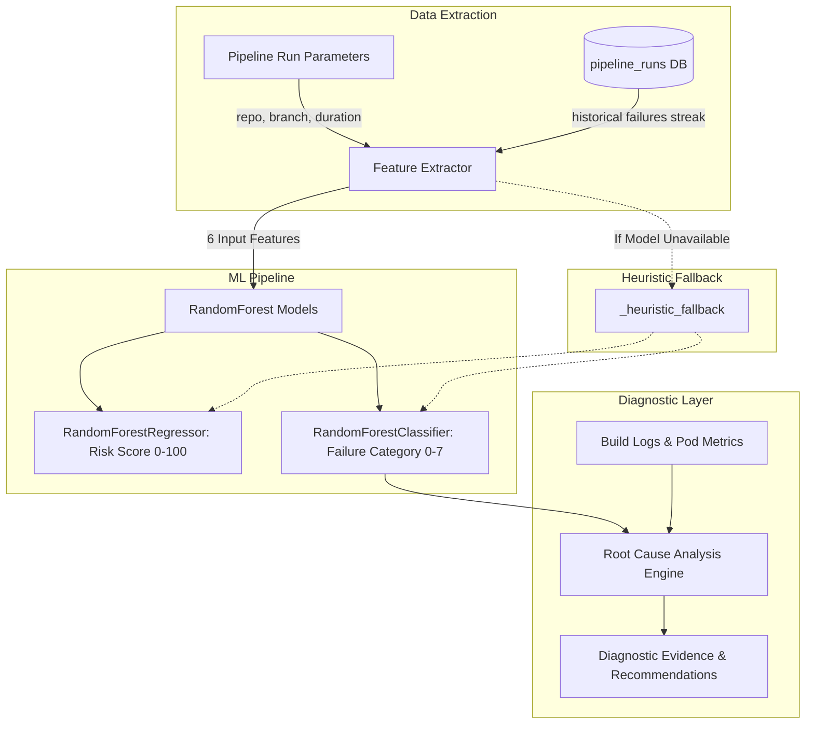

# CortexCICD — AI/ML Architecture & Predictive Engine

## 1. Overview & Machine Learning Problem Formulation

The CortexCICD AI engine tackles two core operational challenges before and during CI/CD execution:
1. **Failure Risk Scoring (Regression):** Quantifying the probability of pipeline failure on a scale of `0` to `100`.
2. **Failure Type Classification (Multiclass Classification):** Identifying the specific failure category if a pipeline run fails, allowing the Self-Healing Engine to immediately select an optimal remediation strategy.
3. **Root Cause Analysis (RCA):** Parsing console logs and pod restart telemetry via regex pattern matching to synthesize evidence-backed root cause explanations and preventative recommendations.



---

## 2. Dataset Origin & Characterization

### Real Historical Data vs. Synthetic Generation
- **Source:** The model training engine in `ml/predict_failure.py` operates on a **synthetically generated domain-specific dataset** ($N = 2,000$ training records).
- **Design Decision:** Real CI/CD historical datasets often suffer from severe class imbalance (90%+ builds succeed) and lack standardized logging across heterogeneous repositories. Synthetic generation ensures balanced exposure across all known infrastructure failure modes.
- **Repository Balancing File:** The file `ml/mock_dataset.py` contains 2,604 serialized dummy entries used for repository layout testing, while the actual ML training pipeline generates mathematical distributions via `np.random` with a fixed seed (`random_state=42`).

---

## 3. Feature Engineering & Mathematical Formulations

The model extracts **6 numerical and categorical features** for every pipeline run:

| Feature Name | Type | Range | Description & Domain Significance |
| :--- | :--- | :--- | :--- |
| `branch_is_main` | Binary (int) | `0` or `1` | Feature branch (`0`) vs `main`/trunk (`1`). Feature branches have historically higher volatility. |
| `files_changed` | Integer | `0` to $\infty$ | Scope of the commit. Larger diffs correlate strongly with integration and merge failures. |
| `hour_of_day` | Integer | `0` to `23` | Hour of commit execution. Accounts for deployment fatigue and off-peak automated triggers. |
| `day_of_week` | Integer | `0` to `6` | Day of week (`0` = Monday, `6` = Sunday). Weekend commits often experience unattended runner delays. |
| `duration_secs` | Integer | `0` to $\infty$ | Expected or elapsed pipeline runtime. Long-running builds indicate hanging tests or memory starvation. |
| `consecutive_failures` | Integer | `0` to $\infty$ | Historical failure streak queried dynamically from `pipeline_runs` for the specific `repo + branch`. |

### Synthetic Risk Score Generation Formula:
During model generation, ground truth risk scores are calculated using domain heuristics:
$$\text{Base Risk} = (1 - \text{branch\_is\_main}) \times 15 + \min(\text{files\_changed}, 60) \times 0.5 + (\text{consecutive\_failures} \times 12) + \mathbb{I}(\text{duration\_secs} > 250) \times 20 + \epsilon$$
where $\epsilon \sim \text{Uniform}(-8, 15)$, and the final score is clipped to $[0, 100]$.

---

## 4. Model Architectures & Hyperparameters

CortexCICD trains two distinct **Random Forest** estimators using `scikit-learn`:

### 1. Risk Estimator (`RandomForestRegressor`)
- **Estimators (`n_estimators`):** `100` decision trees.
- **Criterion:** Squared error (MSE).
- **Parallelism (`n_jobs`):** `-1` (utilizes all available CPU cores).
- **Random State:** `42` for exact reproducibility.
- **Target Output:** Continuous value in $[0, 100]$.

### 2. Failure Category Classifier (`RandomForestClassifier`)
- **Estimators (`n_estimators`):** `100` decision trees.
- **Criterion:** Gini impurity.
- **Target Classes (`FAILURE_TYPES`):**
  1. `None` (Normal execution, Risk < 60)
  2. `Test Suite Timeout`
  3. `OOM — Pod Evicted`
  4. `Dependency Resolution`
  5. `Build Script Error`
  6. `High CPU Saturation`
  7. `Network Timeout`
  8. `Liveness Probe Fail`

### Model Serialization & Persistence
- The trained estimators are bundled into a dictionary `{"risk_model": risk_model, "type_model": type_model}` and serialized via `pickle` to `ml/models/failure_predictor.pkl` (~13.5 MB).
- On application startup, `_load_or_train()` attempts to load the cached pickle file. If missing or corrupted, it automatically executes the training routine in under 2 seconds.

---

## 5. Confidence Scoring & Heuristic Fallback

### Confidence Calibration
Confidence for failure type classification is derived from class prediction probabilities:
$$\text{Confidence} = \max_{k} P(Y = k \mid X)$$
- **Score $\ge 0.90$:** `Very High`
- **Score $\ge 0.75$:** `High`
- **Score $\ge 0.55$:** `Medium`
- **Score $< 0.55$:** `Low`

### Fallback Logic (`_heuristic_fallback`)
If `scikit-learn` or the pickle file cannot be accessed, the engine falls back to deterministic rule sets:
```python
risk = 10
if branch != "main": risk += 15
if files_changed > 30: risk += 20
if duration_secs > 300: risk += 25
risk += min(consecutive_failures * 15, 40)
```
This guarantees that failure risk predictions never raise unhandled 500 exceptions in production.

---

## 6. Root Cause Analysis (RCA) Engine

Located in `ml/root_cause.py`, the RCA engine operates independently of model inference to produce human-auditable diagnoses:

| Pattern ID | Matching Log Regular Expressions | Identified Root Cause | Prescribed Remediation |
| :--- | :--- | :--- | :--- |
| `oom_kill` | `OOMKilled`, `Killed`, `memory limit`, `cannot allocate memory` | Container exceeded memory ceiling and was terminated by kernel OOM-killer. | Increase Kubernetes memory limit; enable VPA; run CI memory profiler. |
| `crash_loop` | `CrashLoopBackOff`, `liveness probe failed`, `Back-off restarting` | Application crashing repeatedly on startup due to configuration or port mismatch. | Verify `EXPOSE` port matches K8s probe; check env vars; add startup probe buffer. |
| `network_timeout`| `timeout`, `connection timed out`, `deadline exceeded`, `ETIMEDOUT` | External API call or network service did not respond within deadline window. | Increase timeout thresholds; implement circuit breaker pattern; check DNS egress. |
| `dependency_error`| `pip._internal`, `npm ERR!`, `Could not resolve`, `404 Not Found` | Package resolution failure due to missing or unpinned dependency version. | Pin exact package versions in lockfile; configure internal artifact proxy mirror. |
| `cpu_throttled` | `cpu limit`, `throttling`, `high cpu`, `100% cpu` | Container CPU utilization exceeded ceiling, triggering kernel CFS throttling. | Increase CPU limit; configure Horizontal Pod Autoscaler (HPA) CPU target to 75%. |

---

## 7. Known ML Limitations & Production Roadmap

1. **Synthetic Training Data:** While statistically structured around real DevSecOps distributions, the model has not been trained on live production git commit telemetry or Jenkins XML build archives.
2. **Tabular Feature Scope:** Predictions do not yet perform Natural Language Processing (NLP) or LLM embeddings over source code diffs or commit messages.
3. **Static Class Labels:** New failure types (e.g., cloud provider quota limits or secret scan blocks) require updating the hardcoded `FAILURE_TYPES` enum and retraining.

