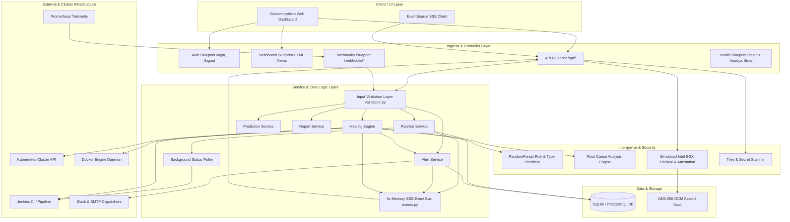
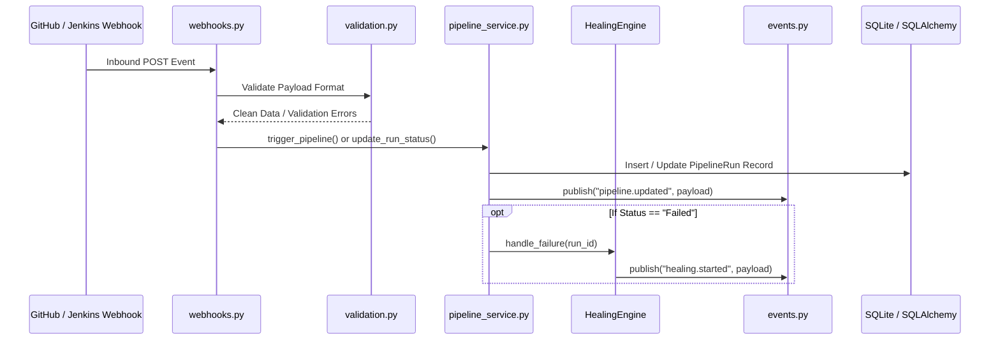
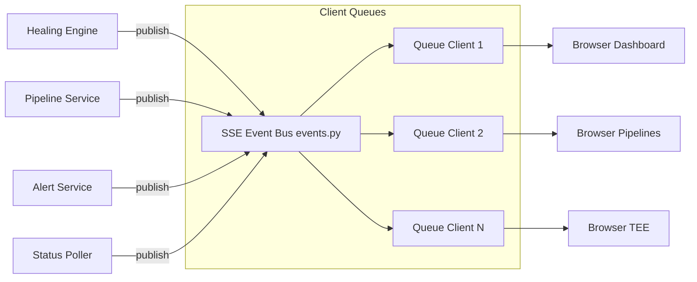

# CortexCICD — Backend Architecture & System Design

## 1. System Overview & Component Topology

CortexCICD is built as an event-driven, resilient application structured around Python Flask, SQLAlchemy ORM, and integrated DevSecOps toolchains. The backend serves both RESTful API endpoints and Server-Sent Event (SSE) streams, while executing autonomous self-healing strategies and continuous background polling.

---

## 2. Blueprint & Controller Layer

The web and API layer is divided into 5 distinct Flask Blueprints registered in `app/app.py`:

| Blueprint | Prefix | Source File | Responsibilities |
| :--- | :--- | :--- | :--- |
| `auth_bp` | `/` | `app/routes/auth.py` | Session-based login/logout, credentials verification against environment variables (`ADMIN_USERNAME`, `ADMIN_PASSWORD`). |
| `dashboard_bp` | `/` | `app/routes/dashboard.py` | Jinja2 server-side rendered HTML pages (Dashboard, Pipeline, Kubernetes, Monitoring, TEE, Alerts, Deployments, Logs, Settings, Docs). |
| `api_bp` | `/api` | `app/routes/api.py` | 37 JSON REST endpoints for CRUD actions, ML predictions, RCA analysis, healing triggers, report exports, Docker, K8s, TEE, and SSE stream. |
| `webhooks_bp` | `/webhooks` | `app/routes/webhooks.py` | Inbound webhooks from GitHub (`/webhooks/github`), Jenkins (`/webhooks/jenkins`), and Prometheus Alertmanager (`/webhooks/prometheus`). |
| `health_bp` | `/` | `app/routes/health.py` | Kubernetes-standard probes: `/healthz` (liveness check), `/readyz` (readiness + DB check), `/livez` (uptime & component status). |

### Session & Authentication Interceptor
- Authentication is governed by Flask session cookies (`session["logged_in"] = True`).
- In `app/routes/dashboard.py`, a `@login_required` decorator intercepts unauthenticated requests and redirects to `/login`.
- API endpoints check session state or bypass for local service integration where appropriate.

---

## 3. Service Layer Architecture

The service layer encapsulates business logic, decoupling Flask request/response mechanics from state mutations:

### Key Services:
1. **`pipeline_service.py`**:
   - `trigger_pipeline(repo, branch, triggered_by, job_name)`: Creates `PipelineRun` in state `In Progress`, computes risk score via ML predictor, triggers Jenkins build (or mock), and initiates background status polling.
   - `update_run_status(run_id, status, duration_secs)`: Updates run outcome (`Success`, `Failed`, `Healed`), emits SSE events, and invokes `HealingEngine` on failure.
   - `get_consecutive_failures(repo, branch)`: Traverses run history in reverse chronological order to calculate failure streaks for ML risk weighting.

2. **`alert_service.py`**:
   - Manages state machine transitions: `Active` ➔ `Acknowledged` ➔ `Resolved` ➔ `Archived` (with optional `Silenced` expiration).
   - Generates notifications to Slack and Email via `dispatcher.py`.

3. **`prediction_service.py`**:
   - Gathers historical context (`consecutive_failures`, `duration_secs`, `branch`, `files_changed`) to drive `ml/predict_failure.py`.
   - Bridges to `ml/root_cause.py` to extract evidence, root causes, and remediation guidance.

4. **`report_service.py`**:
   - Compiles operational run histories, healing logs, and AI diagnostics into PDF format using `ReportLab` (falling back to JSON).

---

## 4. Real-Time SSE Event Bus (`app/events.py`)

CortexCICD utilizes an in-memory, thread-safe publish-subscribe Event Bus built exclusively with Python standard library constructs (`threading.Lock`, `queue.Queue`):

### Event Specifications:
- **`pipeline.updated`**: Emitted when a run changes state (`In Progress`, `Success`, `Failed`, `Healed`).
- **`healing.started`**: Emitted when the self-healing engine initiates recovery for a run.
- **`healing.resolved` / `healing.failed`**: Emitted upon strategy execution completion.
- **`alert.new` / `alert.updated`**: Emitted when alerts are triggered, acknowledged, or resolved.

### Constraints & Safety Guarantees:
- **Max Clients (`_MAX_CLIENTS = 50`)**: Prevents memory exhaustion on concurrent socket connections.
- **Queue Buffering (`_QUEUE_SIZE = 100`)**: Drops slow or non-responsive SSE listeners automatically (`queue.Full`).
- **Keepalive Ping**: Sends `: ping\n\n` comments every 15 seconds to prevent browser/proxy connection timeouts.

---

## 5. Background Polling & Schedulers

CortexCICD runs background daemon threads for non-blocking asynchronous state synchronization:

### 1. `StatusPoller` (`app/services/status_poller.py`)
- Watches builds triggered in Jenkins that are currently `In Progress`.
- Polls Jenkins REST API (`jenkins_client.get_build_info`) every 3 seconds.
- Handles timeout deadlines (default: 600s).
- On build completion, automatically invokes `update_run_status()`.

### 2. Healing Health Check Scheduler (`app/healing/scheduler.py`)
- Background thread executing periodic health sweeps (default: every 60 seconds).
- Validates that healed pods remain running and that Kubernetes services recover nominal response latency.

---

## 6. Database Connection Management

- Database interactions use **Flask-SQLAlchemy 3.1.1** with SQLite (default: `app/cortex.db`) or PostgreSQL (via `DATABASE_URL`).
- Transactions are scoped to requests (`db.session`).
- Automatic schema creation and deterministic data seeding occur in `_seed_if_empty()` on initial boot.

