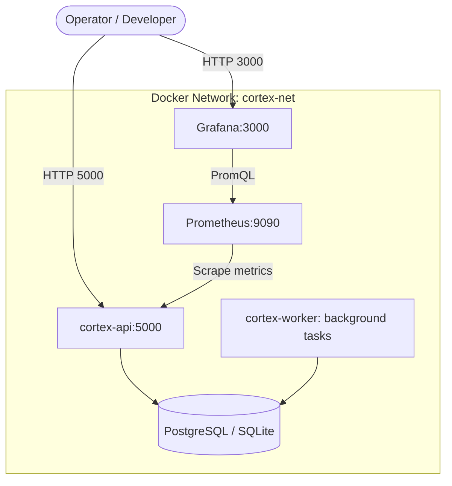

# CortexCICD — Production Deployment & Operations Guide

## 1. Prerequisites & System Requirements

- **Operating System:** Linux (Ubuntu 22.04 LTS / RHEL 9 recommended), macOS, or Windows 10/11 with WSL2.
- **Runtime:** Python 3.10, 3.11, or 3.12.
- **Container Runtime:** Docker Engine 24.0+ and Docker Compose v2+.
- **Orchestration (Optional for Full Features):** Kubernetes 1.26+ (Minikube, Kind, k3s, EKS, GKE, or AKS).
- **CI Server (Optional for Real Builds):** Jenkins 2.400+ with Pipeline and Git plugins.

---

## 2. Local Development Deployment

### 1. Clone Repository & Initialize Virtual Environment
```bash
git clone https://github.com/CortexCICD/cortex-CICD.git
cd cortex-CICD

python -m venv .venv
source .venv/bin/activate  # On Windows: .venv\Scripts\activate
pip install -r requirements.txt
```

### 2. Configure Environment Variables
Create a local `.env` file from the reference below:
```ini
FLASK_APP=app/app.py
FLASK_ENV=development
SECRET_KEY=change-this-to-a-secure-random-token
ADMIN_USERNAME=admin
ADMIN_PASSWORD=change-this-password

# Optional Integrations (Defaults to realistic mock mode if omitted)
JENKINS_URL=http://localhost:8080
JENKINS_USER=admin
JENKINS_TOKEN=your-jenkins-api-token

K8S_KUBECONFIG=~/.kube/config
K8S_NAMESPACE=default

PROMETHEUS_URL=http://localhost:9090
GITHUB_WEBHOOK_SECRET=your-github-webhook-secret
```

### 3. Initialize & Run Application
```bash
# Start the Flask web application and background threads
python -m flask run --host=0.0.0.0 --port=5000
```
Access the dashboard at `http://localhost:5000` and login with your configured credentials.

---

## 3. Docker & Docker Compose Deployment

CortexCICD provides production-ready multi-container orchestration defined in `docker/docker-compose.yml`.



### 1. Start Services via Docker Compose
```bash
cd docker
docker compose up -d --build
```

### 2. Verify Running Containers
```bash
docker compose ps
```
Services exposed:
- **Nginx Reverse Proxy Gateway:** `http://localhost:80` (production-grade unbuffered SSE + rate limiting)
- **Cortex API & Web UI:** `http://localhost:5000`
- **Cortex Worker Metrics:** `http://localhost:9101`
- **Prometheus UI:** `http://localhost:9090`
- **Grafana UI:** `http://localhost:3000` (Default credentials: `admin` / `admin`)

---

## 4. Kubernetes Cluster Deployment

Production Kubernetes manifests are located in `kubernetes/`:

### 1. Configure Cluster Secrets
Copy and populate secrets from the template:
```bash
cp kubernetes/secret.yaml.example kubernetes/secret.yaml
# Edit kubernetes/secret.yaml with strong production credentials
kubectl apply -f kubernetes/secret.yaml
```

### 2. Configure RBAC Permissions for the Self-Healing Engine
The self-healing engine requires Kubernetes RBAC permissions to inspect and delete pods, roll back deployments, and adjust replica counts:
```bash
kubectl apply -f kubernetes/healing-rbac.yaml
```
*`healing-rbac.yaml` defines a `ServiceAccount` (`cortex-healing-sa`), `ClusterRole`, and `ClusterRoleBinding` granting access to `pods`, `deployments`, `replicasets`, and `events`.*

### 3. Deploy Cortex Workloads, Service & Ingress
```bash
kubectl apply -f kubernetes/deployment.yaml
kubectl apply -f kubernetes/service.yaml
kubectl apply -f kubernetes/ingress.yaml
```

### 3. Verify Pod & Health Probes
```bash
kubectl get pods -l app=cortex-api
kubectl describe pod -l app=cortex-api
```
*Health probes automatically query `/healthz` (liveness) and `/readyz` (readiness).*

---

## 5. Observability Setup: Prometheus & Grafana

### 1. Prometheus Telemetry Scraping
The configuration in `monitoring/prometheus.yml` scrapes the Cortex application metrics endpoint:
```yaml
global:
  scrape_interval: 15s

scrape_configs:
  - job_name: 'cortex-api'
    metrics_path: '/api/prometheus/metrics'
    static_configs:
      - targets: ['cortex-api:5000']
```

### 2. Pre-Configured Grafana Dashboard
Import `monitoring/grafana-dashboard.json` into Grafana to instantly visualize:
- Total pipeline runs and success/failure ratios
- Self-healing recovery resolution rate
- Active alerts categorized by severity
- Pod memory and CPU saturation graphs

---

## 6. Jenkins Pipeline Integration

### 1. Shared Pipeline Library (`jenkins/cortex-plugin.groovy`)
Place `cortex-plugin.groovy` in your Jenkins global pipeline library to enable failure interception steps:
- `cortexWatch { ... }`: Wraps build stages to capture stderr and execution durations.
- `cortexReportFailure { ... }`: Automatically transmits failure payloads to `http://<cortex-api>/webhooks/jenkins`.

### 2. Example Jenkinsfile (`jenkins/Jenkinsfile.example`)
Include post-build failure hooks in your target project repositories:
```groovy
post {
    failure {
        cortexReportFailure(
            webhook: 'http://cortex-api.cortex-system.svc.cluster.local/webhooks/jenkins',
            extractLogs: true,
            autoHeal: true
        )
    }
}
```

---

## 7. Environment Variables Reference

| Variable | Default Value | Purpose |
| :--- | :--- | :--- |
| `FLASK_APP` | `app/app.py` | Flask entry point. |
| `SECRET_KEY` | `cortex-secret-key-change-in-production` | Secret used to sign session cookies. |
| `ADMIN_USERNAME` | `admin` | Dashboard login username. |
| `ADMIN_PASSWORD` | `admin123` | Dashboard login password. |
| `DATABASE_URL` | `sqlite:///app/cortex.db` | SQLAlchemy database connection URI. |
| `JENKINS_URL` | `""` (Empty = mock mode) | URL of upstream Jenkins server. |
| `JENKINS_USER` | `""` | Jenkins HTTP authentication user. |
| `JENKINS_TOKEN` | `""` | Jenkins API user token. |
| `K8S_KUBECONFIG`| `~/.kube/config` | File path to Kubernetes config. |
| `K8S_NAMESPACE` | `default` | Target Kubernetes namespace for healing. |
| `PROMETHEUS_URL`| `http://localhost:9090` | Prometheus server base URL. |
| `GITHUB_WEBHOOK_SECRET` | `""` | Secret key for validating GitHub webhook HMAC signatures. |
| `SLACK_WEBHOOK_URL` | `""` | Incoming Slack webhook for escalation notifications. |
| `SMTP_SERVER` | `""` | Outbound SMTP relay server hostname. |
| `STRICT_WEBHOOK_VERIFICATION` | `false` | Set `true` in production to reject webhooks with no/invalid HMAC. |
| `SESSION_COOKIE_SECURE` | `false` | Set `true` in production when served over HTTPS. |
| `ENFORCE_CSRF` | `true` | Reject state-changing requests without a valid CSRF token. |
| `TRUSTED_PROXY_COUNT` | `0` | Number of trusted reverse-proxy hops (Nginx adds 1). |
| `CORTEX_ENCLAVE_MASTER_KEY` | `""` | 32-byte hex key for HMAC-signing ML model bundles. Falls back to `SECRET_KEY`. |
| `TRIVY_PATH` | `trivy` | Path to the Trivy binary (enables real vulnerability scans). |
| `COSIGN_PATH` | `cosign` | Path to the Cosign binary (enables real image signature verification). |
| `SYFT_PATH` | `syft` | Path to the Syft binary (enables real SBOM generation). |

---

## 8. Kubernetes Autoscaling

Apply the HPA manifest after deploying the core manifests:
```bash
kubectl apply -f kubernetes/hpa.yaml
```

The `cortex-api` HPA scales between **2 and 10 replicas** targeting 70% CPU / 80% memory.
The `cortex-worker` HPA scales between **1 and 5 replicas** targeting 70% CPU.

> **Prerequisite:** The Kubernetes [Metrics Server](https://github.com/kubernetes-sigs/metrics-server)
> must be installed in the cluster (`kubectl apply -f https://github.com/kubernetes-sigs/metrics-server/releases/latest/download/components.yaml`).

---

## 9. Publishing Docker Images

Tag a release to automatically publish images to GHCR via the `publish.yml` workflow:
```bash
git tag v1.0.0
git push origin v1.0.0
```

Images are published to:
```
ghcr.io/<owner>/cortex-cicd-api:<version>
ghcr.io/<owner>/cortex-cicd-worker:<version>
```

Pull in Kubernetes by updating `kubernetes/deployment.yaml` `image:` fields accordingly.

---

## 10. Security CLIs (Trivy · Cosign · Syft)

The Docker images install these binaries automatically at build time.
For bare-metal deployments, install them manually:

```bash
# Trivy
curl -sfL https://raw.githubusercontent.com/aquasecurity/trivy/main/contrib/install.sh | sh -s -- -b /usr/local/bin

# Cosign
COSIGN_VERSION="v2.4.1"
curl -sSfL "https://github.com/sigstore/cosign/releases/download/${COSIGN_VERSION}/cosign-linux-amd64" \
    -o /usr/local/bin/cosign && chmod +x /usr/local/bin/cosign

# Syft
curl -sSfL https://raw.githubusercontent.com/anchore/syft/main/install.sh | sh -s -- -b /usr/local/bin
```

Without these binaries, the `/api/security/*` endpoints return clearly-labelled mock results.

