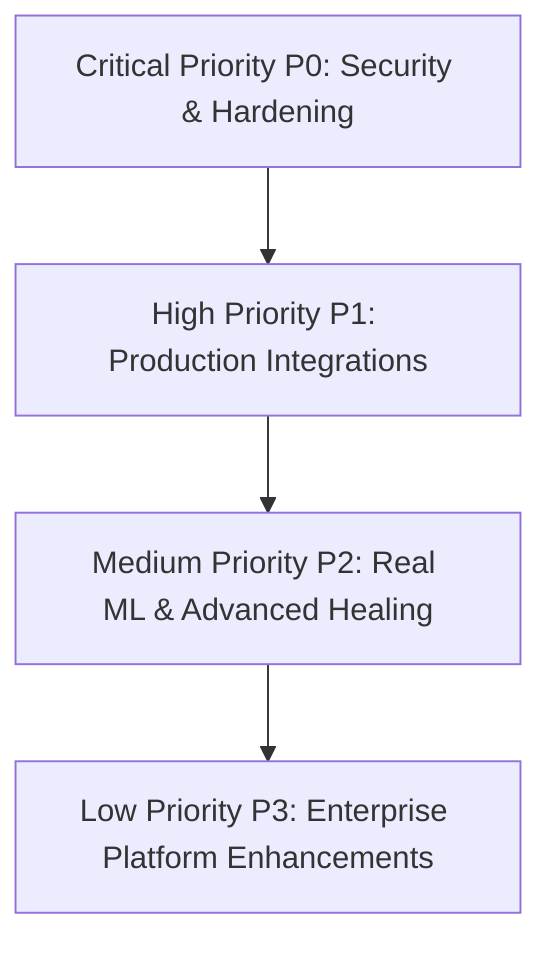

# CortexCICD — Project Roadmap & Technical Gap Analysis

This roadmap provides an honest technical assessment of implemented versus pending capabilities in CortexCICD, establishing a clear development timeline to transition this platform from prototype/demonstration status to enterprise production readiness.

---

## 1. Current Feature Inventory & Status Matrix

| Subsystem / Capability | Implementation State | Verification Mechanism | Notes |
| :--- | :--- | :--- | :--- |
| **Main Dashboard & Glassmorphism UI** | **Fully Implemented** | HTML Templates / CSS / JS | 10+ reactive screens with glassmorphism dark theme. |
| **CI/CD Pipeline Management** | **Fully Implemented** | `pipeline_service.py` / Tests | Run tracking, durations, branch filtering, risk history. |
| **GitHub Webhook Ingestion** | **Fully Implemented** | `webhooks.py` / `test_webhooks.py` | Handles `push` and `ping`; extracts commit diffs. |
| **Jenkins Integration** | **Integrated (Hybrid)** | `jenkins_client.py` / Mock | Real python-jenkins calls if credentials exist; graceful mock fallback. |
| **AI Failure Prediction** | **Integrated (Synthetic)** | `predict_failure.py` / `test_ml.py` | RandomForestRegressor & Classifier trained on synthetic domain data. |
| **Root Cause Analysis (RCA)** | **Fully Implemented** | `root_cause.py` / `test_api.py` | Regex pattern matching over logs, error traces, and pod metrics. |
| **Autonomous Self-Healing Engine** | **Fully Implemented** | `engine.py` / `test_healing.py` | Closed-loop execution: Detect ➔ Predict ➔ Heal ➔ Verify ➔ Alert. |
| **Automatic Retry Strategy** | **Integrated (Hybrid)** | `strategies.py` | Triggers Jenkins build queue; mock fallback. |
| **Kubernetes Pod Restart** | **Integrated (Hybrid)** | `strategies.py` / `k8s_client.py` | Deletes K8s pod via `CoreV1Api`; mock fallback. |
| **Deployment Rollback** | **Integrated (Hybrid)** | `strategies.py` / `k8s_client.py` | Rolls back K8s deployment revision; mock fallback. |
| **Automatic Scaling Strategy** | **Integrated (Hybrid)** | `strategies.py` / `k8s_client.py` | Scales replicas within bounds `[1, 10]`; mock fallback. |
| **Failure Escalation** | **Fully Implemented** | `strategies.py` / `dispatcher.py`| Dispatches critical alerts, Slack webhook, and email notifications. |
| **Docker Container Client** | **Integrated (Hybrid)** | `docker_client.py` | Real Docker SDK connection; mock fallback. |
| **Kubernetes Client** | **Integrated (Hybrid)** | `k8s_client.py` | Real Kubernetes SDK connection; mock fallback. |
| **Prometheus Monitoring** | **Integrated (Hybrid)** | `prometheus_client.py` | Scrapes HTTP rate and system metrics; mock fallback. |
| **Grafana Visualization** | **Fully Implemented** | `grafana-dashboard.json` | Pre-built JSON dashboard configuration. |
| **Trivy Vulnerability Scan** | **Integrated (Hybrid)** | `scanner.py` / `test_security.py`| CLI invocation of `trivy image`; mock fallback. |
| **Secret Detection** | **Fully Implemented** | `secret_scanner.py` / Tests | Regex scanner for AWS, GitHub, Slack, and private keys. |
| **Syft SBOM Generation** | **Partially Implemented** | `Jenkinsfile.example` | Documented and scripted in Jenkins pipeline; no Python API wrapper. |
| **Cosign Image Signing** | **Partially Implemented** | `Jenkinsfile.example` | Documented and scripted in Jenkins pipeline; no Python API wrapper. |
| **Simulated TEE Enclave** | **Fully Implemented (Software)**| `enclave.py` / `test_api.py` | Software simulation of Intel SGX MRENCLAVE & MRSIGNER. |
| **Remote Attestation** | **Fully Implemented (Software)**| `attestation.py` / `test_api.py` | Software simulation of Intel Attestation Service (IAS) quotes. |
| **Sealed Secret Storage** | **Fully Implemented** | `secure_storage.py` / AES-GCM | Encrypts secrets using AES-256-GCM enclave key to `secrets.enc`. |
| **Alert Lifecycle Management** | **Fully Implemented** | `alert_service.py` / Tests | States: `Active`, `Acknowledged`, `Silenced`, `Resolved`, `Archived`. |
| **Real-Time SSE Stream** | **Fully Implemented** | `events.py` / `/api/stream` | Thread-safe in-memory pub/sub with 50-client connection limit. |
| **Background Status Poller** | **Fully Implemented** | `status_poller.py` / Tests | Daemon thread monitoring active builds until completion. |
| **Input Validation Layer** | **Fully Implemented** | `validation.py` / 21 Tests | Strict regex and integer range validation on all inputs. |
| **Database ORM & Migrations** | **Fully Implemented** | `models.py` / SQLite / Postgres | 4 SQLAlchemy models with automatic initial seed. |
| **PDF Report Generation** | **Fully Implemented** | `reports/generator.py` | ReportLab PDF compilation for Pipeline, Healing, and AI reports. |
| **Automated Test Suite** | **Fully Implemented** | `tests/` (11 files, 69 tests) | **100% passing tests (69 / 69).** |

---

## 2. Prioritized Technical Backlog

### 🔴 Critical Priority (P0) — Security & Core Robustness
1. **Remove Hardcoded Secrets:** Enforce non-default `SECRET_KEY` and `ADMIN_PASSWORD` in production.
2. **Mandatory Webhook Signatures:** Fail closed with HTTP 401 when `X-Hub-Signature-256` does not match `GITHUB_WEBHOOK_SECRET`.
3. **Hardware-Backed Key Storage:** Migrate the plaintext `.enclave_key` to a secure hardware security module (HSM) or cloud KMS.
4. **SSE Connection Rate Limiting:** Enforce per-IP connection limits to prevent socket exhaustion attacks on `/api/stream`.

### 🟠 High Priority (P1) — Integration Completeness
1. **Python Syft SBOM Service:** Create `app/security/sbom.py` wrapping the Syft CLI to generate and return CycloneDX/SPDX SBOMs via `/api/security/sbom`.
2. **Python Cosign Verification Service:** Create `app/security/cosign.py` to verify container image signatures against public keys inside the application API.
3. **PostgreSQL Migration Tooling:** Add Alembic / Flask-Migrate integration for managing schema evolutions without dropping tables.

### 🟡 Medium Priority (P2) — ML & Real-World Telemetry
1. **Train ML on Real Historical Telemetry:** Transition model training from synthetic `numpy` generation to historical Jenkins XML archives and GitHub commit metadata.
2. **NLP / Code Diff Embeddings:** Incorporate code-change embeddings (e.g., CodeBERT or TF-IDF on commit messages) to improve failure risk precision.
3. **Adaptive Thresholds:** Dynamically adjust the risk threshold for triggering rollbacks based on historical service level objectives (SLOs).

### 🟢 Low Priority (P3) — Enterprise Scalability
1. **Distributed Event Bus:** Replace the single-process in-memory SSE queue with Redis Pub/Sub to allow horizontal scaling across multiple Gunicorn workers.
2. **Real Intel SGX / Gramine Enclave Support:** Support running the secret vault inside a true hardware-backed Intel SGX or AMD SEV enclave using Gramine OS or Anjuna.
3. **Multi-Tenancy & RBAC:** Implement organization-level workspace isolation and role-based permissions (Admin, Operator, Read-Only Viewer).

