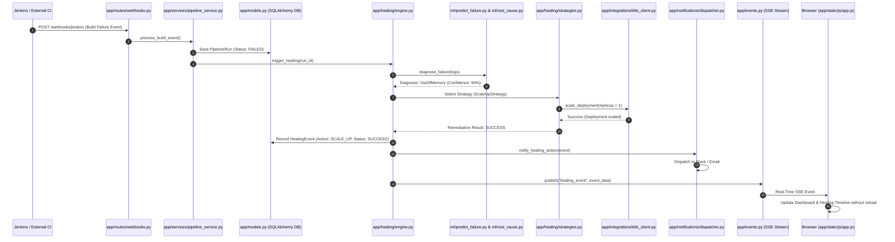

# Cortex CI/CD — Project & File Structure Guide

This document provides a comprehensive overview of the **Cortex CI/CD** repository structure. It catalogs every directory and file, explaining the role, functional responsibilities, and architectural layer of each component.

---

## 📑 Table of Contents

- [1. Visual Repository Tree](#1-visual-repository-tree)
- [2. Root Configuration & Entrypoints](#2-root-configuration--entrypoints)
- [3. GitHub Workflows & Governance (`.github/`)](#3-github-workflows--governance-github)
- [4. Core Application (`app/`)](#4-core-application-app)
  - [4.1 App Core & Middleware](#41-app-core--middleware)
  - [4.2 Self-Healing Engine (`app/healing/`)](#42-self-healing-engine-apphealing)
  - [4.3 Third-Party Integrations (`app/integrations/`)](#43-third-party-integrations-appintegrations)
  - [4.4 Notification Dispatchers (`app/notifications/`)](#44-notification-dispatchers-appnotifications)
  - [4.5 Route Controllers & APIs (`app/routes/`)](#45-route-controllers--apis-approutes)
  - [4.6 DevSecOps & Security Tools (`app/security/`)](#46-devsecops--security-tools-appsecurity)
  - [4.7 Business Services (`app/services/`)](#47-business-services-appservices)
  - [4.8 Frontend Assets (`app/static/`)](#48-frontend-assets-appstatic)
  - [4.9 TEE & Confidential Computing (`app/tee/`)](#49-tee--confidential-computing-apptee)
  - [4.10 UI Templates (`app/templates/`)](#410-ui-templates-apptemplates)
- [5. Containerization & Deployment (`docker/`)](#5-containerization--deployment-docker)
- [6. Technical Documentation (`docs/`)](#6-technical-documentation-docs)
- [7. Jenkins CI Integration (`jenkins/`)](#7-jenkins-ci-integration-jenkins)
- [8. Kubernetes Orchestration Manifests (`kubernetes/`)](#8-kubernetes-orchestration-manifests-kubernetes)
- [9. Machine Learning & Diagnostics (`ml/`)](#9-machine-learning--diagnostics-ml)
- [10. Telemetry & Monitoring (`monitoring/`)](#10-telemetry--monitoring-monitoring)
- [11. Audit Reporting (`reports/`)](#11-audit-reporting-reports)
- [12. Maintenance & Helper Scripts (`scripts/`)](#12-maintenance--helper-scripts-scripts)
- [13. Encrypted Vault Storage (`tee/`)](#13-encrypted-vault-storage-tee)
- [14. Test Suites & Verification (`tests/`)](#14-test-suites--verification-tests)
- [15. Component Interaction Flow](#15-component-interaction-flow)

---

## 1. Visual Repository Tree

```text
cortex-CICD/
│
├── .github/                                # CI/CD automation & issue templates
│   ├── ISSUE_TEMPLATE/
│   │   ├── bug_report.yml                  # Structured bug report issue form
│   │   ├── config.yml                      # GitHub issue template configuration
│   │   └── feature_request.yml             # Structured feature request form
│   ├── workflows/
│   │   ├── ci.yml                          # Continuous integration (lint, test, coverage)
│   │   ├── docker-build.yml                # Docker build & security scan workflow
│   │   └── publish.yml                     # Package/container release & publish pipeline
│   ├── PULL_REQUEST_TEMPLATE.md            # Standard PR checklist and template
│   └── SECURITY.md                         # Security vulnerability reporting policy
│
├── app/                                    # Main backend application package
│   ├── healing/                            # Autonomous remediation & decision engine
│   │   ├── __init__.py                     # Package init
│   │   ├── engine.py                       # Healing coordinator and execution core
│   │   ├── scheduler.py                    # Background self-healing poll cycle
│   │   └── strategies.py                   # Concrete remediation strategies (Retry, PodRestart, Rollback, ScaleUp)
│   ├── integrations/                       # External infrastructure client adapters
│   │   ├── __init__.py                     # Package init
│   │   ├── docker_client.py                # Docker Engine API client with mock fallback
│   │   ├── jenkins_client.py               # Jenkins REST client with build & log retrieval
│   │   ├── k8s_client.py                   # Kubernetes API client for pod and deployment actions
│   │   └── prometheus_client.py            # Prometheus metric query adapter with mock fallback
│   ├── notifications/                      # Alert dispatching channel adapters
│   │   ├── __init__.py                     # Package init
│   │   ├── dispatcher.py                   # Multi-channel notification dispatcher
│   │   ├── email.py                        # SMTP email sender with alert templates
│   │   └── slack.py                        # Slack webhook payload builder & sender
│   ├── routes/                             # HTTP route blueprints & API controllers
│   │   ├── __init__.py                     # Blueprint aggregator & registration
│   │   ├── alerts_api.py                   # Alert query, ack, and resolve endpoints (/api/alerts)
│   │   ├── auth.py                         # Authentication & session controllers (/login, /logout)
│   │   ├── dashboard.py                    # HTML dashboard view routes
│   │   ├── health.py                       # Health probe endpoints (/healthz, /livez, /readyz)
│   │   ├── infra_api.py                    # Infrastructure telemetry endpoints (/api/infra/*)
│   │   ├── pipeline_api.py                 # Pipeline run management APIs (/api/pipelines/*)
│   │   ├── security_api.py                 # Security scanning, SBOM, and TEE attestation APIs
│   │   ├── settings_api.py                 # System configuration APIs (/api/settings)
│   │   ├── sse_api.py                      # Server-Sent Events stream endpoint (/api/events)
│   │   └── webhooks.py                     # Inbound CI/CD webhook listeners (/webhooks/*)
│   ├── security/                           # DevSecOps security toolchain
│   │   ├── __init__.py                     # Package init
│   │   ├── cosign.py                       # Container image digital signature verification
│   │   ├── sbom.py                         # Syft Software Bill of Materials generation & check
│   │   ├── scanner.py                      # Trivy vulnerability scanner parser & orchestrator
│   │   └── secret_scanner.py               # Regex/entropy secret and credential detector
│   ├── services/                           # Application business logic layer
│   │   ├── __init__.py                     # Package init
│   │   ├── alert_service.py                # Alert lifecycle, deduplication, and state management
│   │   ├── healing_service.py              # Self-healing orchestration and history retrieval
│   │   ├── monitoring_service.py           # Infrastructure metric collation and status summary
│   │   ├── notification_service.py         # Notification routing and escalation policies
│   │   ├── pipeline_service.py             # Jenkins sync, build triggers, and log persistence
│   │   ├── prediction_service.py           # ML failure probability calculation & feature gathering
│   │   ├── report_service.py               # PDF/CSV/JSON compliance report generator
│   │   └── status_poller.py                # Periodic Jenkins build status synchronization
│   ├── static/                             # Frontend assets
│   │   ├── css/
│   │   │   └── style.css                   # Glassmorphism dark UI styling & responsiveness
│   │   ├── img/
│   │   │   └── logo.png                    # Application logo and icons
│   │   └── js/
│   │       └── app.js                      # Dynamic client script, SSE listeners, Chart.js configs
│   ├── tee/                                # Trusted Execution Environment (Confidential Computing)
│   │   ├── __init__.py                     # Package init
│   │   ├── attestation.py                  # Remote attestation quote generation & validation
│   │   ├── enclave.py                      # Simulated Intel SGX enclave runtime
│   │   ├── secrets.py                      # Cryptographic key derivation and secret encryption
│   │   └── secure_storage.py               # Sealed vault storage engine with AES-256-GCM
│   ├── templates/                          # Jinja2 HTML views
│   │   ├── alerts.html                     # Active and resolved alerts dashboard
│   │   ├── base.html                       # Global layout with sidebar and header
│   │   ├── dashboard.html                  # Main overview dashboard
│   │   ├── deployments.html                # Deployment status and environment health
│   │   ├── docs.html                       # In-app technical documentation browser
│   │   ├── index.html                      # Landing page
│   │   ├── kubernetes.html                 # Kubernetes cluster pod/workload viewer
│   │   ├── login.html                      # Glassmorphism login page
│   │   ├── logs.html                       # Real-time streaming log viewer
│   │   ├── monitoring.html                 # Metrics, CPU, memory, and telemetry charts
│   │   ├── pipeline.html                   # CI/CD pipeline manager & trigger interface
│   │   ├── prediction.html                 # ML failure risk scoring and prediction interface
│   │   ├── self_healing.html               # Autonomous self-healing timeline & history
│   │   ├── settings.html                   # Platform parameters and integration config
│   │   └── tee.html                        # Confidential enclave & sealed secrets viewer
│   ├── app.py                              # Flask application factory (create_app)
│   ├── auth_guard.py                       # Session and API authentication decorator
│   ├── config.py                           # Central configuration & environment variables
│   ├── db.py                               # SQLAlchemy database instance & session binding
│   ├── events.py                           # In-memory and Redis Pub/Sub SSE event bus
│   ├── http_security.py                    # Security headers middleware (CSP, HSTS, X-Frame)
│   ├── models.py                           # SQLAlchemy ORM models (PipelineRun, Alert, HealingEvent)
│   ├── observability.py                    # Prometheus metric definitions & telemetry helpers
│   └── validation.py                       # Input sanitization and payload validators
│
├── docker/                                 # Containerization & reverse proxy configs
│   ├── Dockerfile.api                      # Multi-stage Dockerfile for the Cortex API
│   ├── Dockerfile.worker                   # Dockerfile for the background worker
│   ├── docker-compose.yml                  # Local development compose stack
│   ├── docker-compose.prod.yml             # Production compose stack (Nginx, Postgres, Redis)
│   └── nginx.conf                          # Production Nginx reverse proxy configuration
│
├── docs/                                   # Architectural and operational documentation
│   ├── AI_ML_DOCUMENTATION.md              # ML model design, feature extraction, and RCA patterns
│   ├── API_DOCUMENTATION.md                # Comprehensive REST API specifications
│   ├── BACKEND_ARCHITECTURE.md             # System design, thread concurrency, and data models
│   ├── COMPLETE_PROJECT_DOCUMENTATION.md   # Unified end-to-end technical documentation
│   ├── DEPLOYMENT_GUIDE.md                 # Production deployment, Docker, and K8s setup
│   ├── PROJECT_ROADMAP.md                  # Milestone tracking, vision, and roadmap
│   ├── PROJECT_STRUCTURE.md                # (This file) Complete directory & file breakdown
│   ├── SECURITY_ARCHITECTURE.md            # Threat model, TEE enclave specs, and DevSecOps
│   └── SELF_HEALING_WORKFLOW.md            # Closed-loop autonomous healing decision trees
│
├── jenkins/                                # Jenkins CI pipeline and config
│   ├── casc.yaml                           # Jenkins Configuration-as-Code (JCasC) definition
│   ├── cortex-plugin.groovy                # Groovy script for automated Jenkins webhook setup
│   └── Jenkinsfile.example                 # Declarative pipeline template with DevSecOps stages
│
├── kubernetes/                             # Kubernetes cloud-native deployment manifests
│   ├── deployment.yaml                     # Deployments for Cortex API and background worker
│   ├── healing-rbac.yaml                   # ClusterRole & RoleBinding for automated remediation
│   ├── hpa.yaml                            # Horizontal Pod Autoscaler configuration
│   ├── ingress.yaml                        # Ingress controller configuration with TLS
│   ├── namespace.yaml                      # Kubernetes namespace (cortex-system)
│   ├── secret.yaml.example                 # Sample Kubernetes Secret template
│   └── service.yaml                        # ClusterIP and NodePort Service definitions
│
├── ml/                                     # Machine learning models & log diagnostics
│   ├── data_collector.py                   # CI/CD telemetry collector & synthetic dataset generator
│   ├── feature_extractor.py                # Transforms raw build metrics into model features
│   ├── predict_failure.py                  # RandomForestClassifier for risk score & failure prediction
│   ├── requirements.txt                    # Python dependencies for ML (scikit-learn, pandas)
│   └── root_cause.py                       # Pattern-matching engine diagnosing build log errors
│
├── monitoring/                             # Telemetry, alerting rules & Grafana dashboards
│   ├── grafana-provisioning/
│   │   ├── dashboards/
│   │   │   └── dashboard.yml               # Automated dashboard provider configuration
│   │   └── datasources/
│   │       └── prometheus.yml              # Prometheus datasource provider configuration
│   ├── alerts.yml                          # Prometheus alerting rules for critical failures
│   ├── grafana-dashboard.json              # Pre-configured Grafana dashboard JSON layout
│   └── prometheus.yml                      # Prometheus scrape configurations and endpoints
│
├── reports/                                # Audit & compliance report generation
│   ├── __init__.py                         # Package init
│   └── generator.py                        # Generates PDF (ReportLab), CSV, and JSON audit reports
│
├── scripts/                                # Utility and automation scripts
│   ├── apply_k8s.ps1                       # PowerShell script to deploy all K8s manifests
│   ├── generate_balance.py                 # Balances synthetic training data for model retraining
│   └── init_jenkins.py                     # Programmatic setup of Jenkins jobs and webhooks
│
├── tee/                                    # Sealed secret storage directory
│   └── secrets.enc                         # Encrypted AES-256-GCM sealed secret vault
│
├── tests/                                  # Pytest automated test suites
│   ├── conftest.py                         # Pytest fixtures, mock DB, and client initialization
│   ├── run_tests.py                        # CLI test runner script with formatted reporting
│   ├── test_alert_lifecycle.py             # Tests for alert creation, deduplication, and resolution
│   ├── test_api.py                         # End-to-end integration tests for REST API routes
│   ├── test_healing.py                     # Tests for healing strategies (Retry, PodRestart, Rollback)
│   ├── test_health.py                      # Tests for health probes (/healthz, /livez, /readyz)
│   ├── test_ml.py                          # Tests for ML feature extraction and risk scoring
│   ├── test_notifications.py               # Tests for Slack and Email notification handlers
│   ├── test_pipeline_service.py            # Tests for Jenkins sync and pipeline execution logic
│   ├── test_realworld.py                   # E2E simulated production failure and recovery tests
│   ├── test_security.py                    # Tests for secret scanner, Trivy parsing, and TEE enclave
│   ├── test_status_poller.py               # Tests for background Jenkins polling worker
│   ├── test_validation.py                  # Tests for input sanitization and schema validators
│   └── test_webhooks.py                    # Tests for inbound webhook parsing and handling
│
├── .env.example                            # Sample environment variables configuration template
├── .gitattributes                          # Git repository line-ending and language attributes
├── .gitignore                              # Git exclusion patterns (venv, pycache, sqlite, logs)
├── CONTRIBUTING.md                         # Contribution workflow, coding standards, and PR process
├── entrypoint.py                           # Container startup script (ensures ML model, starts Gunicorn)
├── LICENSE                                 # Open-source MIT license
├── README.md                               # Project overview, architecture diagrams, and quickstart
├── requirements.txt                        # Production Python dependencies
├── run.py                                  # Local development runner (Flask dev server)
├── worker.py                               # Dedicated background worker daemon (scheduler + poller)
└── wsgi.py                                 # WSGI entrypoint for production servers (Gunicorn/uWSGI)
```

---

## 2. Root Configuration & Entrypoints

| File | Purpose & Responsibilities |
| :--- | :--- |
| **`.env.example`** | Documents all environment variable keys with safe defaults (database connection strings, secret keys, Jenkins credentials, Kubernetes flags, Prometheus endpoints, TEE settings, and Slack/SMTP notification parameters). |
| **`.gitattributes`** | Sets line ending normalizations (`eol=lf`) and language overrides across git operations. |
| **`.gitignore`** | Specifies files and patterns ignored by version control (virtual environments, Python bytecode, SQLite databases, sensitive `.env` files, logs, and build artifacts). |
| **`CONTRIBUTING.md`** | Details guidelines for open-source contributors, covering branch naming, testing conventions, pull request checklists, and code standards. |
| **`entrypoint.py`** | Docker container initialization script. Checks whether the pre-trained ML model (`failure_predictor.pkl`) exists; if absent, triggers initial training on synthetic data before launching the multi-worker Gunicorn server. |
| **`LICENSE`** | MIT Open Source license terms. |
| **`README.md`** | Primary project documentation containing architecture diagrams, feature breakdown, getting-started guides, screenshots, and operational instructions. |
| **`requirements.txt`** | Pins top-level Python dependencies including Flask, SQLAlchemy, scikit-learn, requests, PyYAML, Docker SDK, Kubernetes client, and ReportLab. |
| **`run.py`** | Developer entrypoint for running the Flask application locally with hot-reloading and debug output. |
| **`worker.py`** | Standalone background worker daemon. Runs the autonomous self-healing scheduler (`HealingScheduler`), continuous Jenkins build status polling (`StatusPoller`), and periodic Prometheus worker telemetry. |
| **`wsgi.py`** | WSGI compliant entrypoint exposing the Flask `application` callable for production WSGI servers such as Gunicorn or uWSGI. |

---

## 3. GitHub Workflows & Governance (`.github/`)

Manages repository CI/CD pipelines, issue forms, pull request templates, and security guidelines.

| File / Folder | Purpose & Responsibilities |
| :--- | :--- |
| **`.github/`** | Root folder containing GitHub automation workflows, issue templates, and governance policies. |
| **`workflows/ci.yml`** | Continuous integration pipeline executing on push/PR: sets up Python, installs dependencies, runs flake8 linting, and executes pytest test suites with code coverage reporting. |
| **`workflows/docker-build.yml`** | Builds multi-container Docker images (API and Worker) on changes and scans images for vulnerabilities. |
| **`workflows/publish.yml`** | Automated release workflow for tagging, packaging, and publishing Docker container images to registries. |
| **`ISSUE_TEMPLATE/`** | Directory hosting structured GitHub issue forms. |
| **`ISSUE_TEMPLATE/bug_report.yml`** | Structured YAML form guiding users through reporting defects with reproduction steps, environment details, and error logs. |
| **`ISSUE_TEMPLATE/config.yml`** | Configures community contact links and issue template chooser options. |
| **`ISSUE_TEMPLATE/feature_request.yml`** | Structured YAML form for feature proposals, use cases, and design specifications. |
| **`PULL_REQUEST_TEMPLATE.md`** | Markdown template enforcing PR descriptions, linked issue references, testing verification, and security checks. |
| **`SECURITY.md`** | Security policy detailing supported versions and responsible disclosure procedures for vulnerabilities. |

---

## 4. Core Application (`app/`)

The primary application package containing the Flask web backend, REST APIs, database schemas, and business services.

### 4.1 App Core & Middleware

| File | Purpose & Responsibilities |
| :--- | :--- |
| **`app/app.py`** | Application factory function (`create_app`). Configures database initialization, registers all route blueprints, mounts error handlers, sets up CORS, and optionally starts in-process background threads for local development. |
| **`app/auth_guard.py`** | Authentication and authorization decorators (`@login_required`, `@api_key_required`) protecting endpoints via session state or Bearer tokens. |
| **`app/config.py`** | Centralized configuration class (`Config`). Parses environment variables with sensible defaults for database paths, encryption keys, service timeouts, and operational thresholds. |
| **`app/db.py`** | Instantiates the SQLAlchemy ORM `db` object and provides session management helpers. |
| **`app/events.py`** | In-memory and Redis-backed Pub/Sub event bus. Distributes Server-Sent Events (SSE) to connected browser clients for real-time dashboard updates without page reloads. |
| **`app/http_security.py`** | Middleware injecting hardened HTTP response headers (Content-Security-Policy, HSTS, X-Content-Type-Options, X-Frame-Options) to protect against XSS and clickjacking. |
| **`app/models.py`** | Declarative SQLAlchemy database models: `PipelineRun`, `HealingEvent`, `Alert`, `PlatformSetting`, and `SecurityScanResult`. |
| **`app/observability.py`** | Defines custom Prometheus metric counters, gauges, and histograms (`cortex_pipeline_runs_total`, `cortex_healing_events_total`, `cortex_alerts_active`). |
| **`app/validation.py`** | Input validation layer validating request bodies, parameter bounds, string sanitization, and URL formats before business logic processing. |

### 4.2 Self-Healing Engine (`app/healing/`)

Automates failure detection, root-cause correlation, and autonomous execution of remediation strategies.

| File / Folder | Purpose & Responsibilities |
| :--- | :--- |
| **`app/healing/`** | Sub-package implementing closed-loop autonomous remediation. |
| **`engine.py`** | Core remediation coordinator (`HealingEngine`). Analyzes pipeline failure logs, selects matching healing strategies, triggers execution, records audit events in the database, and alerts operators. |
| **`scheduler.py`** | Periodic background scheduler (`HealingScheduler`). Scans the database at configured intervals for un-remediated pipeline failures and initiates healing workflows. |
| **`strategies.py`** | Concrete remediation strategy classes: `AutoRetryStrategy` (retries transient pipeline failures), `PodRestartStrategy` (restarts crashed K8s pods), `RollbackStrategy` (rolls back failed deployments), `ScaleUpStrategy` (scales replica sets for OOM/load), and `EscalateStrategy` (notifies engineers when auto-healing is exhausted). |

### 4.3 Third-Party Integrations (`app/integrations/`)

Client adapters providing resilient communication with external infrastructure services, equipped with mock fallbacks for testing and local operation.

| File / Folder | Purpose & Responsibilities |
| :--- | :--- |
| **`app/integrations/`** | Sub-package encapsulating external API clients. |
| **`docker_client.py`** | Communicates with the Docker Engine daemon via the Docker SDK. Queries container status, restarts containers, and provides simulated container telemetry when Docker is offline. |
| **`jenkins_client.py`** | Interacts with the Jenkins REST API. Triggers jobs, tracks build status, extracts console logs for diagnostic parsing, and provides mock build simulation. |
| **`k8s_client.py`** | Interfaces with the Kubernetes cluster via `kubernetes-client`. Lists pods/deployments, performs pod evictions/restarts, updates replica counts, and manages rollbacks. |
| **`prometheus_client.py`** | Queries Prometheus PromQL endpoints to retrieve real-time CPU utilization, memory pressure, and HTTP error rates with synthetic fallbacks. |

### 4.4 Notification Dispatchers (`app/notifications/`)

Routes incident alerts and remediation notifications to team communication channels.

| File / Folder | Purpose & Responsibilities |
| :--- | :--- |
| **`app/notifications/`** | Sub-package managing outgoing alert notifications. |
| **`dispatcher.py`** | Central notification orchestrator. Receives alert events and broadcasts them across enabled channels based on severity and user configuration. |
| **`email.py`** | SMTP email sender. Generates HTML and plain-text emails for high-severity alerts and incident escalation. |
| **`slack.py`** | Slack integration. Formats rich JSON Slack Block Kit payloads and posts messages to incoming webhook URLs. |

### 4.5 Route Controllers & APIs (`app/routes/`)

HTTP endpoints split cleanly between browser views and programmatic REST APIs.

| File / Folder | Purpose & Responsibilities |
| :--- | :--- |
| **`app/routes/`** | Sub-package organizing Flask route blueprints. |
| **`alerts_api.py`** | REST endpoints (`/api/alerts`) to fetch active/historical alerts, acknowledge notifications, and resolve open incidents. |
| **`auth.py`** | User authentication routes (`/login`, `/logout`) handling credential validation and session state management. |
| **`dashboard.py`** | View routes rendering HTML templates (`/`, `/dashboard`, `/pipeline`, `/healing`, `/monitoring`, `/kubernetes`, `/settings`, etc.). |
| **`health.py`** | Kubernetes liveness and readiness probe endpoints (`/healthz`, `/livez`, `/readyz`). |
| **`infra_api.py`** | Telemetry APIs (`/api/infra/*`) returning live statistics for Docker containers, Kubernetes workloads, and Prometheus metrics. |
| **`pipeline_api.py`** | Pipeline control APIs (`/api/pipelines/*`) to trigger new builds, inspect execution logs, cancel builds, and list run histories. |
| **`security_api.py`** | Security endpoints (`/api/security/*`) providing container image scanning, secret detection results, and TEE attestation verification. |
| **`settings_api.py`** | Platform configuration endpoints (`/api/settings`) to inspect and update operational thresholds and webhook endpoints. |
| **`sse_api.py`** | Server-Sent Events endpoint (`/api/events`) streaming real-time pipeline status, telemetry, and alert notifications to frontend clients. |
| **`webhooks.py`** | Webhook receivers (`/webhooks/jenkins`, `/webhooks/github`) parsing inbound build status and commit notifications from external CI servers. |

### 4.6 DevSecOps & Security Tools (`app/security/`)

Security automation utilities for supply chain verification, vulnerability scanning, and credential protection.

| File / Folder | Purpose & Responsibilities |
| :--- | :--- |
| **`app/security/`** | Sub-package hosting DevSecOps scanning and verification tools. |
| **`cosign.py`** | Integrates with Sigstore Cosign to verify cryptographic digital signatures and attestation certificates of container images before deployment. |
| **`sbom.py`** | Software Bill of Materials (SBOM) generator and parser supporting Syft/SPDX formats to audit container dependencies. |
| **`scanner.py`** | Vulnerability assessment module parsing Trivy vulnerability reports, categorizing CVEs by severity (Critical, High, Medium, Low). |
| **`secret_scanner.py`** | High-entropy and pattern-based secret scanner detecting leaked API keys, tokens, and private keys in source code and configuration files. |

### 4.7 Business Services (`app/services/`)

The core business logic layer decoupling HTTP controllers from low-level data access and external integrations.

| File / Folder | Purpose & Responsibilities |
| :--- | :--- |
| **`app/services/`** | Sub-package containing business domain services. |
| **`alert_service.py`** | Manages alert records, deduplication logic, severity classification, and automatic resolution when resources recover. |
| **`healing_service.py`** | Manages autonomous and manual healing operations, audit logs, and recovery metric calculations. |
| **`monitoring_service.py`** | Collates telemetry from Prometheus, Docker, and Kubernetes into unified health dashboards. |
| **`notification_service.py`** | Applies notification rules, throttling, and channel routing logic. |
| **`pipeline_service.py`** | Coordinates pipeline execution, synchronizes status with Jenkins, and persists stage-level metrics. |
| **`prediction_service.py`** | Extracts pipeline features, queries the ML model for failure probabilities, and provides actionable recommendations. |
| **`report_service.py`** | Compiles executive summaries, compliance reports, and incident audits into downloadable formats. |
| **`status_poller.py`** | Background poller continuously updating running Jenkins builds to maintain fresh state in the local database. |

### 4.8 Frontend Assets (`app/static/`)

Client-side styling, scripts, and graphical assets powering the user interface.

| File / Folder | Purpose & Responsibilities |
| :--- | :--- |
| **`app/static/`** | Static assets served directly to the browser. |
| **`css/style.css`** | Custom glassmorphism stylesheet featuring dark theme aesthetics, responsive grid layouts, animations, and badges. |
| **`img/logo.png`** | Project logo and branding icons. |
| **`js/app.js`** | Core frontend JavaScript. Manages Server-Sent Events (SSE) connections, interactive Chart.js graphs, dynamic table filtering, modal dialogues, and asynchronous API calls. |

### 4.9 TEE & Confidential Computing (`app/tee/`)

Simulated Trusted Execution Environment (Intel SGX) providing confidential compute boundaries and hardware-level secret protection.

| File / Folder | Purpose & Responsibilities |
| :--- | :--- |
| **`app/tee/`** | Sub-package providing confidential computing capabilities. |
| **`attestation.py`** | Generates cryptographic remote attestation quotes (simulating Intel SGX ECDSA quotes) and verifies enclave integrity measurements (MRENCLAVE / MRSIGNER). |
| **`enclave.py`** | Secure enclave runtime executing sensitive cryptographic operations (token signing, sensitive key handling) in isolated execution memory. |
| **`secrets.py`** | Hardware-derived key management routines for sealing and unsealing secrets within the enclave. |
| **`secure_storage.py`** | Sealed vault storage implementation writing AES-256-GCM encrypted secrets to disk, ensuring data remains protected even if the host OS is compromised. |

### 4.10 UI Templates (`app/templates/`)

Jinja2 templates rendering the dashboard UI.

| File / Folder | Purpose & Responsibilities |
| :--- | :--- |
| **`app/templates/`** | Server-side HTML templates. |
| **`alerts.html`** | Incident management page displaying active alerts, severity filters, acknowledgement controls, and audit logs. |
| **`base.html`** | Base layout template including head metadata, navigation sidebar, top breadcrumbs, status indicators, and asset scripts. |
| **`dashboard.html`** | Central command dashboard displaying system health cards, failure risk gauges, live build feeds, and cluster metrics. |
| **`deployments.html`** | Environment health and deployment timeline tracking active releases across staging and production. |
| **`docs.html`** | Built-in interactive technical and API documentation reader. |
| **`index.html`** | Landing page introducing the Cortex platform. |
| **`kubernetes.html`** | Kubernetes cluster console showing pod health, restart counts, replica status, and direct restart triggers. |
| **`login.html`** | Glassmorphism authentication card for user sign-in. |
| **`logs.html`** | Streaming log viewer with real-time log search and severity filtering. |
| **`monitoring.html`** | Infrastructure telemetry dashboard featuring interactive CPU, memory, and error-rate time series. |
| **`pipeline.html`** | CI/CD pipeline management interface showing build stages, duration, and manual trigger controls. |
| **`prediction.html`** | ML failure prediction view detailing build risk scores, contributing risk factors, and prevention tips. |
| **`self_healing.html`** | Autonomous remediation console displaying healing audit timelines, action success rates, and manual intervention controls. |
| **`settings.html`** | Platform configuration interface for tuning notification webhooks, alert thresholds, and integration credentials. |
| **`tee.html`** | Confidential computing console displaying enclave measurements, attestation quotes, and sealed secret status. |

---

## 5. Containerization & Deployment (`docker/`)

Configurations for building, running, and orchestrating Cortex in containerized environments.

| File / Folder | Purpose & Responsibilities |
| :--- | :--- |
| **`docker/`** | Container definitions and server configurations. |
| **`Dockerfile.api`** | Multi-stage Dockerfile packaging the web application, installing Python dependencies, pre-training the ML model, and configuring Gunicorn. |
| **`Dockerfile.worker`** | Lightweight Dockerfile packaging the standalone background worker daemon (`worker.py`). |
| **`docker-compose.yml`** | Local development stack orchestrating the Cortex API, Worker, Redis Pub/Sub, and Prometheus. |
| **`docker-compose.prod.yml`** | Production multi-container stack incorporating PostgreSQL database, Redis, Nginx reverse proxy, and hardened security settings. |
| **`nginx.conf`** | High-performance Nginx reverse proxy configuration with TLS termination, rate-limiting zones, buffer optimizations, and static asset caching. |

---

## 6. Technical Documentation (`docs/`)

Comprehensive technical architecture, API, security, and operational documentation.

| File | Purpose & Responsibilities |
| :--- | :--- |
| **`docs/AI_ML_DOCUMENTATION.md`** | In-depth documentation on the machine learning pipeline: feature engineering, RandomForest architecture, synthetic training set design, risk scoring formulas, and regex-based root-cause pattern matching. |
| **`docs/API_DOCUMENTATION.md`** | Full REST API reference detailing all endpoints, request schemas, query parameters, response structures, and status codes. |
| **`docs/BACKEND_ARCHITECTURE.md`** | System architecture guide covering the component topology, database ER diagram, thread concurrency model, SSE pub/sub system, and error-handling patterns. |
| **`docs/COMPLETE_PROJECT_DOCUMENTATION.md`** | Unified end-to-end technical manual consolidating system architecture, deployment steps, feature overviews, and configuration references. |
| **`docs/DEPLOYMENT_GUIDE.md`** | Step-by-step production deployment manual for bare metal, Docker Compose, Kubernetes, and cloud platforms. |
| **`docs/PROJECT_ROADMAP.md`** | Strategic roadmap detailing completed capabilities, current quarterly priorities, and planned future enhancements. |
| **`docs/PROJECT_STRUCTURE.md`** | *(This file)* Comprehensive directory tree, file inventory, and module descriptions for the entire repository. |
| **`docs/SECURITY_ARCHITECTURE.md`** | Security architecture specification detailing threat modeling, TEE enclave simulation, RBAC policies, secret scanning, and vulnerability management. |
| **`docs/SELF_HEALING_WORKFLOW.md`** | Autonomous self-healing specification outlining closed-loop control flows, decision trees, remediation strategies, cooldown intervals, and escalation policies. |

---

## 7. Jenkins CI Integration (`jenkins/`)

Assets for integrating Cortex with Jenkins automation servers.

| File / Folder | Purpose & Responsibilities |
| :--- | :--- |
| **`jenkins/`** | Jenkins configuration and pipeline scripts. |
| **`casc.yaml`** | Jenkins Configuration-as-Code (JCasC) definition automating complete Jenkins server configuration, credentials, plugins, and job definitions. |
| **`cortex-plugin.groovy`** | Groovy initialization script for Jenkins configuring webhook notification hooks that push build events directly to Cortex. |
| **`Jenkinsfile.example`** | Production-ready declarative pipeline demonstrating integration with Trivy security scans, test execution, and post-build Cortex webhook notifications. |

---

## 8. Kubernetes Orchestration Manifests (`kubernetes/`)

Cloud-native deployment manifests for running Cortex on Kubernetes clusters.

| File / Folder | Purpose & Responsibilities |
| :--- | :--- |
| **`kubernetes/`** | Kubernetes YAML manifests. |
| **`deployment.yaml`** | Deployment definitions creating pods for the Cortex API (with readiness/liveness probes) and background worker. |
| **`healing-rbac.yaml`** | ClusterRole, Role, and RoleBinding definitions providing Cortex with scoped permissions to restart pods, rollback deployments, and scale workloads. |
| **`hpa.yaml`** | Horizontal Pod Autoscaler manifest configuring automatic horizontal scaling of API pods between 2 and 10 replicas based on CPU and memory thresholds. |
| **`ingress.yaml`** | Ingress resource configuring routing rules, path mappings, and TLS termination via cert-manager. |
| **`namespace.yaml`** | Declares the dedicated `cortex-system` Kubernetes namespace. |
| **`secret.yaml.example`** | Template for creating Kubernetes Secrets containing database credentials, encryption keys, and API tokens. |
| **`service.yaml`** | Kubernetes Service definitions exposing the API via ClusterIP and NodePort, plus internal metrics endpoints. |

---

## 9. Machine Learning & Diagnostics (`ml/`)

Machine learning models, dataset utilities, and diagnostic log analyzers.

| File / Folder | Purpose & Responsibilities |
| :--- | :--- |
| **`ml/`** | Machine learning and automated root-cause analysis modules. |
| **`data_collector.py`** | Simulates and compiles CI/CD historical build telemetry (lines changed, test durations, flakiness indices, dependency counts) into training datasets. |
| **`feature_extractor.py`** | Feature engineering utility normalizing pipeline metrics into numerical feature vectors required for model inference. |
| **`predict_failure.py`** | Implements the `FailurePredictor` class using scikit-learn's `RandomForestClassifier`. Calculates failure risk scores (0–100%) and predicts the probable failure category. |
| **`requirements.txt`** | Dependency definitions for machine learning (scikit-learn, numpy, pandas). |
| **`root_cause.py`** | Root cause diagnostic engine matching console logs against 7 failure patterns: OutOfMemory, FlakyTest, DependencyError, ConfigError, TimeoutError, SecurityViolation, and NetworkError. |

---

## 10. Telemetry & Monitoring (`monitoring/`)

Observability stack configurations for Prometheus metrics collection and Grafana visualization.

| File / Folder | Purpose & Responsibilities |
| :--- | :--- |
| **`monitoring/`** | Monitoring configurations and dashboards. |
| **`alerts.yml`** | Prometheus alert rules triggering notifications when pod crash loops, elevated API latency, or high pipeline failure rates are detected. |
| **`grafana-dashboard.json`** | Comprehensive Grafana dashboard layout visualizing build metrics, risk score distributions, healing actions, and container health. |
| **`prometheus.yml`** | Prometheus configuration defining scrape intervals and targets for Cortex API, Worker, and Kubernetes nodes. |
| **`grafana-provisioning/dashboards/dashboard.yml`** | Grafana configuration automatically loading the dashboard JSON file on startup. |
| **`grafana-provisioning/datasources/prometheus.yml`** | Grafana datasource configuration setting up Prometheus as the default telemetry backend. |

---

## 11. Audit Reporting (`reports/`)

Exportable compliance and executive audit report generators.

| File / Folder | Purpose & Responsibilities |
| :--- | :--- |
| **`reports/`** | Reporting sub-package. |
| **`__init__.py`** | Package init exporting report generators. |
| **`generator.py`** | Multi-format report builder (`ReportGenerator`). Generates professional PDF audit reports (using ReportLab), CSV spreadsheets, and structured JSON summaries detailing pipeline throughput, incidents, and self-healing success metrics. |

---

## 12. Maintenance & Helper Scripts (`scripts/`)

Operational utilities for administrative setup, local maintenance, and testing automation.

| File / Folder | Purpose & Responsibilities |
| :--- | :--- |
| **`scripts/`** | Administrative utility scripts. |
| **`apply_k8s.ps1`** | PowerShell script automating the sequential deployment of Kubernetes manifests (namespace, secrets, RBAC, deployments, services, ingress, HPA). |
| **`generate_balance.py`** | Dataset generation script creating balanced synthetic training data across all failure categories for model training. |
| **`init_jenkins.py`** | Python setup script utilizing the Jenkins REST API to programmatically provision example CI/CD jobs and configure notification webhooks. |

---

## 13. Encrypted Vault Storage (`tee/`)

Confidential computing sealed storage directory.

| File / Folder | Purpose & Responsibilities |
| :--- | :--- |
| **`tee/`** | Directory hosting hardware-sealed secret artifacts. |
| **`secrets.enc`** | AES-256-GCM encrypted binary storage file holding protected API tokens and credentials, accessible only through the TEE enclave module. |

---

## 14. Test Suites & Verification (`tests/`)

Automated pytest test suite validating all layers of the platform.

| File / Folder | Purpose & Responsibilities |
| :--- | :--- |
| **`tests/`** | Test suite directory containing unit, integration, and end-to-end tests. |
| **`conftest.py`** | Central pytest configuration declaring shared fixtures (mock databases, test clients, dummy pipeline runs, and pre-populated alerts). |
| **`run_tests.py`** | Convenient command-line test runner executing test suites and producing structured status reports. |
| **`test_alert_lifecycle.py`** | Tests alert creation, deduplication keys, status transitions (Active -> Acknowledged -> Resolved), and silencing rules. |
| **`test_api.py`** | Comprehensive integration tests validating REST API endpoints, response structures, and HTTP status codes. |
| **`test_healing.py`** | Tests the self-healing engine and verifies strategy execution (`AutoRetry`, `PodRestart`, `Rollback`, `ScaleUp`, `Escalate`). |
| **`test_health.py`** | Validates the health check endpoints (`/healthz`, `/livez`, `/readyz`). |
| **`test_ml.py`** | Tests feature extraction, ML risk scoring calculations, and failure type classification accuracy. |
| **`test_notifications.py`** | Tests notification formatting, multi-channel dispatch, and Slack/Email payload delivery. |
| **`test_pipeline_service.py`** | Tests pipeline trigger logic, cancellation, status synchronization, and run history persistence. |
| **`test_realworld.py`** | End-to-end simulation test testing full platform behavior under realistic multi-stage failure scenarios (transient failure -> pod crash -> OOM -> recovery). |
| **`test_security.py`** | Validates secret scanner detection, Trivy report parsing, TEE attestation verification, and enclave encryption. |
| **`test_status_poller.py`** | Tests the background status poller's synchronization of external Jenkins build states. |
| **`test_validation.py`** | Validates schema validation, boundary limits, and input sanitization routines against malformed payloads. |
| **`test_webhooks.py`** | Tests inbound webhook parsing for Jenkins and GitHub payloads. |

---

## 15. Component Interaction Flow

The diagram below illustrates how files across different directories collaborate during a real-time build failure and autonomous self-healing event:



---

*Document generated for Cortex CI/CD — Last updated: March 2025.*
