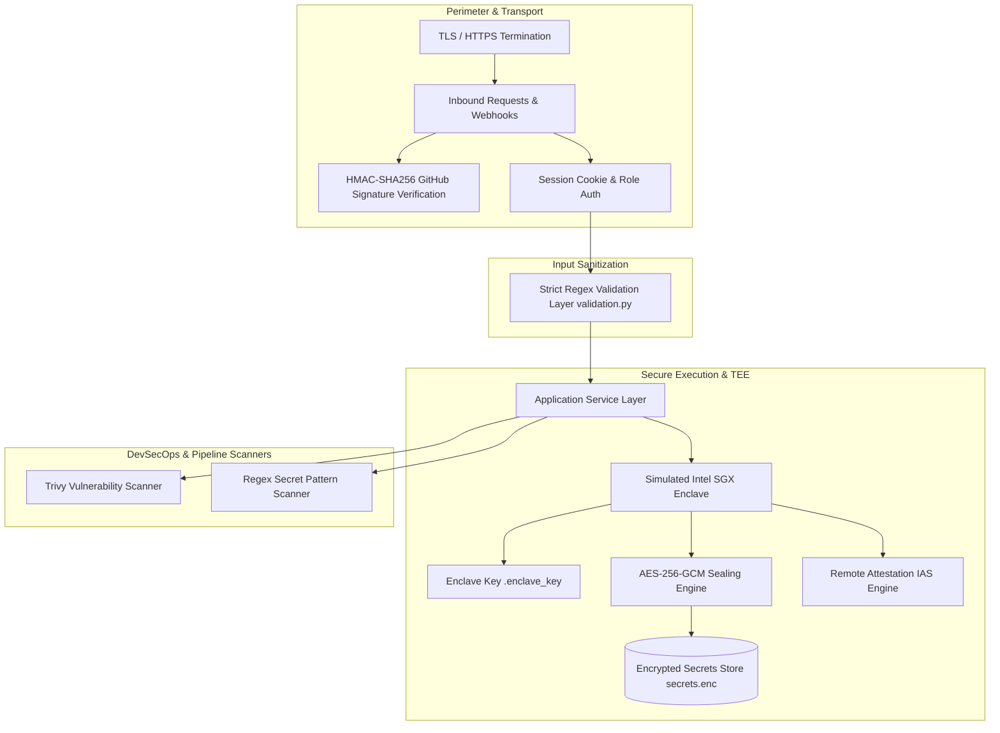

# CortexCICD — Security Architecture & DevSecOps Audit

## 1. Security Architecture Overview

CortexCICD integrates a layered security model spanning application authentication, zero-trust API validation, cryptographic secret sealing via a simulated Trusted Execution Environment (TEE), container vulnerability scanning, and webhook signature verification.

---

## 2. Authentication, Authorization & Session Management

- **Session Mechanism:** Uses Flask client-side encrypted session cookies signed by `SECRET_KEY`.
- **Default Authentication:** Credentials verified against `ADMIN_USERNAME` (default: `admin`) and `ADMIN_PASSWORD` (default: `admin123`).
- **Authorization Guard:** `@login_required` decorator checks `session.get("logged_in")` before serving dashboard and mutating operational routes.

### Security Weaknesses & Fixes:
> [!WARNING]
> 1. **Default Hardcoded Secret:** If `SECRET_KEY` is not set in environment variables, the application defaults to an insecure test string (`"cortex-secret-key-change-in-production"`).
>    - *Remediation:* Enforce application startup failure in non-debug mode if `SECRET_KEY` is not provided via environment or KMS.
> 2. **Session Storage:** Client-side cookies without `Secure` or `HttpOnly` flags explicitly set in production can be vulnerable to XSS inspection.
>    - *Remediation:* Set `SESSION_COOKIE_SECURE = True`, `SESSION_COOKIE_HTTPONLY = True`, and `SESSION_COOKIE_SAMESITE = 'Lax'` in `config.py`.

---

## 3. Input Validation & Injection Defense (`app/validation.py`)

CortexCICD enforces zero-dependency, strict pattern-matching input sanitization across all mutating endpoints:

| Validated Field | Enforcement Pattern | Attack Vectors Mitigated |
| :--- | :--- | :--- |
| `repo` | `^[\w\-./]{1,120}$` | Directory traversal, shell command injection (`rm -rf`, `;`). |
| `branch` | `^[\w\-./]{1,80}$` | Git flag injection (`--upload-pack`), shell command chaining. |
| `image_name` | `^[\w\-./: @]{1,200}$` | Remote container injection, argument injection to Docker/Trivy CLI. |
| `namespace` | `^[\w\-]{1,63}$` | Kubernetes namespace traversal, path manipulation. |
| `replicas` | Integer range `[1, 10]` | Denial of Service (DoS) via resource starvation / scale exhaustion. |
| `silence_hours`| Integer range `[1, 168]` | Permanent suppression of critical infrastructure alerts. |

---

## 4. Trusted Execution Environment (TEE) Simulation

CortexCICD models hardware-isolated confidential computing (Intel SGX) using software cryptographic primitives in `app/tee/`:

### 1. Enclave Measurements (`app/tee/enclave.py`)
- **MRENCLAVE:** Computes a SHA-256 cryptographic digest of the enclave source code module on disk. Any unauthorized tampering or runtime bytecode modification alters this measurement.
- **MRSIGNER:** Computes a SHA-256 hash of the 32-byte enclave sealing key, representing the enclave author/signer identity.

### 2. Hardware Sealing & Storage (`app/tee/secure_storage.py`)
- **Algorithm:** Authenticated AES-256-GCM (`cryptography.hazmat.primitives.ciphers.aead.AESGCM`).
- **Storage:** Sealed secrets are written with an initialization vector (IV) and authentication tag to `secrets.enc`. Data cannot be decrypted outside the enclave runtime.

### 3. Remote Attestation (`app/tee/attestation.py`)
Simulates the **Intel Attestation Service (IAS)** protocol:
- Accepts a cryptographic `nonce` to prevent replay attacks.
- Returns a signed JSON quote containing `mrenclave`, `mrsigner`, timestamp, and a simulated HMAC-SHA256 signature.
- Produces a deterministic `security_score: 100` when TCB (Trusted Computing Base) status is `UpToDate`.

---

## 5. Webhook Security & Signature Verification

Inbound webhooks from GitHub (`POST /webhooks/github`) support HMAC-SHA256 signature verification:
- Inspects header `X-Hub-Signature-256: sha256=<hex_digest>`.
- Uses `hmac.compare_digest` for constant-time comparison to prevent timing attacks.
- **Current Fallback:** If `GITHUB_WEBHOOK_SECRET` is not configured, the endpoint logs a warning and proceeds in permissive mode.
- *Production Requirement:* In production, requests lacking valid HMAC signatures must be rejected with HTTP 401 Unauthorized.

---

## 6. Vulnerability & Secret Scanning

### 1. Trivy Vulnerability Scanner (`app/security/scanner.py`)
- Invokes Trivy CLI: `trivy image --format json --quiet <image_name>`.
- Parses CVE identifiers, package names, CVSS severities, and available patch versions.
- Gracefully falls back to mock vulnerabilities if Trivy binary is not in system PATH.

### 2. Secret Scanner (`app/security/secret_scanner.py`)
- Recursively audits the workspace excluding `.git` and `__pycache__`.
- Scans for 5 distinct secret patterns:
  1. AWS Access Key IDs (`AKIA[0-9A-Z]{16}`)
  2. Generic Private Keys (`-----BEGIN (RSA|EC|DSA|OPENSSH) PRIVATE KEY-----`)
  3. GitHub Personal Access Tokens (`ghp_[a-zA-Z0-9]{36}`)
  4. Slack Webhook URLs (`hooks.slack.com/services/...`)
  5. High-entropy API Keys (`api[_-]?key\s*=\s*['\"][a-zA-Z0-9_\-]{20,}['\"]`)

---

## 7. DevSecOps Pipeline Integration: Jenkins, Syft & Cosign

- **Trivy Image Scan:** Active in both Jenkins pipeline (`Jenkinsfile.example`) and Python API (`/api/security/scan`).
- **Syft SBOM Generation:** Specified in `jenkins/Jenkinsfile.example` (`syft my-app:latest -o json > sbom.json`). *Note: Not currently wrapped as a Python service.*
- **Cosign Image Signing:** Specified in `jenkins/Jenkinsfile.example` (`cosign sign --key env://COSIGN_PRIVATE_KEY my-app:latest`). *Note: Not currently wrapped as a Python service.*

---

## 8. Prioritized Security Recommendations

| Priority | Security Finding | Vulnerability Risk | Recommended Fix |
| :--- | :--- | :--- | :--- |
| **CRITICAL** | Hardcoded default secrets & credentials (`admin123`, `cortex-secret-key...`). | Unauthorized administrative takeover if deployed with default settings. | Enforce startup check requiring unique `ADMIN_PASSWORD` and `SECRET_KEY` when `FLASK_ENV=production`. |
| **HIGH** | Permissive webhook fallback when `GITHUB_WEBHOOK_SECRET` is missing. | Spoofed commit webhooks triggering rogue builds or false healing loops. | Reject unsigned payloads with HTTP 401 when production mode is active. |
| **HIGH** | Plaintext enclave key storage (`.enclave_key`). | Compromise of file gives attacker capability to unseal all vaulted secrets. | Store key in cloud KMS (AWS KMS, GCP KMS, Azure Key Vault) or hardware TPM. |
| **MEDIUM** | In-memory SSE client map lacks per-IP rate limiting. | Potential socket exhaustion via Slowloris-style SSE connections. | Add Flask-Limiter rate limiting on `/api/stream` (e.g., max 5 connections per IP). |
| **LOW** | Subprocess invocation of Trivy CLI without chroot isolation. | Theoretical command flag injection if image name validation were bypassed. | Enforce image name regex strictly prior to `subprocess.run`. |

