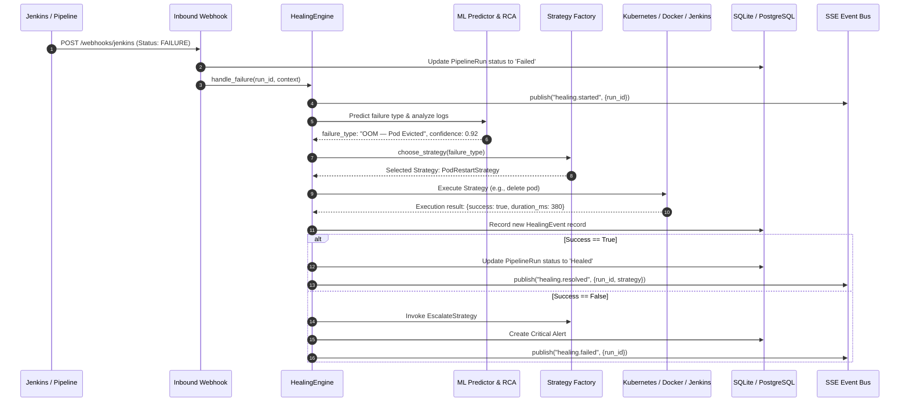

# CortexCICD — Autonomous Self-Healing Workflow & Engine

## 1. Complete Self-Healing Lifecycle

CortexCICD implements an autonomous closed-loop control system that monitors CI/CD pipelines and infrastructure deployments, diagnoses root causes, executes remediation workflows, and verifies recovery.

---

## 2. Strategy Selection Matrix

Remediation strategies are mapped directly to predicted failure categories in `app/healing/strategies.py`:

| Predicted Failure Category | Selected Healing Strategy | Action Description | Primary Recovery Target |
| :--- | :--- | :--- | :--- |
| **Test Suite Timeout** | `AutoRetryStrategy` | Re-triggers build on Jenkins CI server. | Jenkins Job Queue |
| **Network Timeout** | `AutoRetryStrategy` | Re-triggers build; routes through retry backoff. | Jenkins Runner / Network |
| **OOM — Pod Evicted** | `PodRestartStrategy` | Deletes evicted pod; K8s ReplicaSet spawns fresh instance. | Kubernetes Pod |
| **Liveness Probe Fail** | `PodRestartStrategy` | Deletes unresponsive pod to clear stuck deadlock states. | Kubernetes Pod |
| **Dependency Resolution** | `RollbackStrategy` | Rolls back Kubernetes deployment to previous revision. | Kubernetes Deployment |
| **Build Script Error** | `RollbackStrategy` | Rolls back container image tag to last known good build. | Kubernetes Deployment |
| **High CPU Saturation** | `ScaleUpStrategy` | Scales deployment replicas up by +1 (capped at max). | Kubernetes ReplicaSet |
| **Exhausted / Unmatched** | `EscalateStrategy` | Creates Critical Alert and dispatches Slack/Email paging. | On-Call Engineer |

---

## 3. In-Depth Strategy Analysis & Execution Mechanics

### 1. Auto Retry Strategy (`AutoRetryStrategy`)
- **Source:** `app/healing/strategies.py` (Line 51)
- **Execution Mechanism:**
  - Calls `jenkins_client.trigger_build(job_name)`.
  - In real environments, dispatches `POST /job/<name>/build` to Jenkins REST API using API tokens.
  - Waits 1 second for the build to register in the queue.
- **Real vs. Simulated:**
  - **Real:** If `JENKINS_URL` and `JENKINS_TOKEN` are defined in environment variables, an actual HTTP call is made.
  - **Simulated:** If environment variables are missing, `jenkins_client` logs `[Jenkins] No credentials configured — using mock mode` and generates a synthetic queued build number.

### 2. Pod Restart Strategy (`PodRestartStrategy`)
- **Source:** `app/healing/strategies.py` (Line 76)
- **Execution Mechanism:**
  - Invokes `k8s_client.delete_pod(pod_name, namespace)`.
  - Dispatches `DELETE /api/v1/namespaces/{ns}/pods/{name}` via the official Kubernetes Python client (`CoreV1Api`).
  - Kubernetes ReplicaSet controller observes the desired vs. current replica discrepancy and spawns a clean pod container.
- **Real vs. Simulated:**
  - **Real:** If a valid kubeconfig is found at `K8S_KUBECONFIG` or in-cluster service account tokens exist, actual Kubernetes API deletions occur.
  - **Simulated:** If kubeconfig is absent, returns `{success: True, message: "Pod cortex-api-pod deleted successfully."}` without errors.

### 3. Deployment Rollback Strategy (`RollbackStrategy`)
- **Source:** `app/healing/strategies.py` (Line 104)
- **Execution Mechanism:**
  - Calls `k8s_client.rollback_deployment(deployment_name, namespace)`.
  - Fetches the replica revision history and issues an update to restore previous pod template container image specifications.
- **Real vs. Simulated:**
  - **Real:** Interacts with Kubernetes `AppsV1Api` to undo deployment rollout.
  - **Simulated:** Mocks image version decrement (e.g., `v2.4.1` ➔ `v2.4.0`) and logs rollback action.

### 4. Automatic Scale Up Strategy (`ScaleUpStrategy`)
- **Source:** `app/healing/strategies.py` (Line 137)
- **Execution Mechanism:**
  - Queries current deployment replicas via `k8s_client.get_deployment(name, ns)`.
  - Calculates `target_replicas = min(current_replicas + 1, max_replicas)` (default maximum: 10).
  - Calls `k8s_client.scale_deployment(deployment_name, target_replicas, namespace)`.
- **Real vs. Simulated:**
  - **Real:** Patches deployment `spec.replicas` in the live Kubernetes cluster.
  - **Simulated:** Updates mock replica counter in-memory and returns success status.

### 5. Failure Escalation Strategy (`EscalateStrategy`)
- **Source:** `app/healing/strategies.py` (Line 172)
- **Execution Mechanism:**
  - Triggered automatically when an active strategy fails, or when a failure cannot be resolved after 3 consecutive attempts.
  - Creates an unacknowledged `Alert` in the database with severity `Critical`.
  - Dispatches incident notification payloads to Slack webhooks and SMTP email relays via `app/notifications/dispatcher.py`.

---

## 4. Safety Guards & Run-away Protection

1. **Anti-Flapping Thresholds:**
   - The engine checks consecutive failure streaks. If a branch has failed $>3$ times consecutively without successful stabilization, automated retries are aborted and immediate human escalation is triggered.
2. **Maximum Scale Boundaries:**
   - The `ScaleUpStrategy` enforces an upper ceiling of `10` replicas to prevent resource exhaustion or cloud cost runaway.
3. **Database Auditing:**
   - Every single healing attempt writes a durable record to `healing_events` with execution duration, exact strategy invoked, and timestamp.

